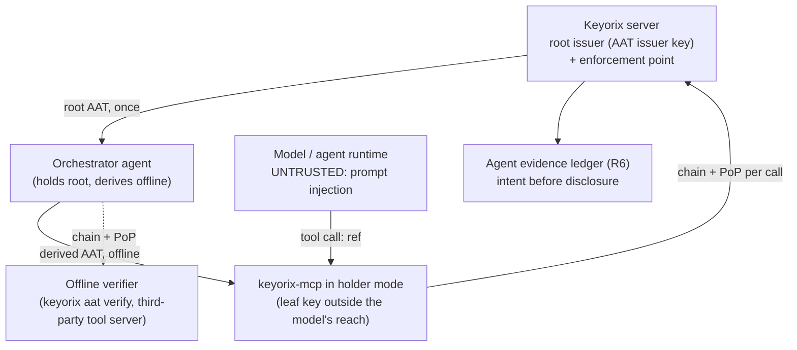

# Threat Model: Attenuating agent tokens (design, not implemented)

> Part of [`docs/security/threat-models/`](README.md). Derived from
> [ADR-116](../../adr-116-attenuating-agent-tokens.md) (Proposed) and
> [`design-rd-aat.md`](../../design-rd-aat.md).
>
> **Nothing in this document is implemented.** Every row is a GAP. The Mitigation
> column names the ADR-116 decision that will carry it. The Evidence column cites
> only tests that exist today: the guard of the mechanism the design reuses (the
> ADR-042 restriction at the `Authorize` chokepoint, the MCP ref allowlist, the OIDC
> JWT checks, the read audit). It never cites a test for the AAT itself. When the
> implementation lands, each row gets its own proving test, named in the Residual
> column.

## 1. System context

## 2. Trust boundaries

| Boundary | What crosses it | Who's on each side |
|---|---|---|
| Issuer ↔ root holder | Root AAT, `req_cnf` key proof | Keyorix and an authenticated machine identity |
| Holder ↔ holder (offline) | Derived AAT signed by the parent holder | Agents that need not trust each other; the chain is the only contract |
| Model ↔ `keyorix-mcp` | Tool name and `ref` | The model is untrusted; the leaf key stays on the `keyorix-mcp` side |
| Presenter ↔ enforcement point | Chain, PoP JWT, invocation | Any presenter; only the leaf key holder can produce a valid PoP |

## 3. Threat table

| ID | STRIDE | Description | Mitigation | Evidence link | Residual risk / GAP |
|---|---|---|---|---|---|
| AAT-1 | Elevation of privilege | A holder derives a child wider than its parent (extra tool, wider `ref`, longer life, more depth). | Section 8 steps 4d-4p deny every widened dimension, with a step and a reason (ADR-116 decisions 1, 7). The rule set is proved sound in the SMT model (design note section 4). | `TestPATRestriction_Allows`; `TestAuthorize_PATRestriction`; `internal/core/authz.go` | GAP: not implemented. Test to add: the draft-02 vector suite plus a pair table of every MUST-reject subsumption pair (design note, commit 1). |
| AAT-2 | Elevation of privilege | Keyorix issues a root wider than the principal's RBAC (for example an environment glob covering environments created later), so offline verifiers accept more than RBAC allows. | Issuance takes the principal's grants as the ceiling for every name, present and future (ADR-116 decision 4). The SMT part F found this exact widening. | `TestRequireMachinePrivilegeCeiling_StorageErrorFailsClosed`; `TestAuthorizePrincipal_Machine` | GAP: not implemented. Test to add: an issuance table test built from the SMT part F cases, including `payments/*/db-password`. |
| AAT-3 | Spoofing | Someone who copies token bytes (from a log, the model context or a tool result) presents them. | Every token names a holder key, and each invocation needs a PoP signed by the leaf key over the tool and arguments (I6, `aat_hash`). Ancestor bytes cannot be presented without their own key. | `TestServe_GetSecretFramedAsUntrustedData`; `internal/mcp/server_test.go` | GAP: not implemented. Test to add: present the root and the child with a stranger's PoP (prototype demo, steps 7b). |
| AAT-4 | Spoofing / repudiation | A captured PoP is replayed within the time window, or at a second replica. | Every `secrets.read` PoP `jti` is recorded in shared storage (insert or nothing, then a read-back), and `aat_aud` must name the server (ADR-116 decision 10). | `TestCTAReview_ClassifyMachineToken_vs_RevokeMachineToken_CrossReplicaPostgres` | GAP: not implemented. Test to add: a cross-replica Postgres test where the same PoP is accepted exactly once. |
| AAT-5 | Tampering | A child is re-attached to a different parent held by the same key, dropping restrictions only the real parent carries. | `par_hash` commits each child to its parent's signing input (I5, step 4q). | `TestValidateOIDCToken_CrossIssuerBindingIsolation` | GAP: not implemented. Test to add: the vectors' 4q group, plus a two-parent substitution test. |
| AAT-6 | Spoofing | Algorithm confusion: `alg: none`, `EdDSA`, a MAC algorithm, a key supplied in a header, or an unknown `crit`. | `Ed25519` allowlist applied per token, consistent with the verifying key. Header keys are ignored. Unknown `crit` denies (ADR-116 decision 11). | `TestOIDCVerifier_RejectsCritHeader`; `TestOIDCVerifier_RejectsFutureIssuedAt` | GAP: not implemented. Test to add: the vectors' 3a/4a/7a groups. |
| AAT-7 | Tampering | A parser differential: duplicate JSON members, or numbers that collapse to the same double, so the verifier and the tool see different values. | Strict parsing with duplicates rejected, number admissibility, JCS comparison of `hta` with the invocation (ADR-116 decision 11). | `TestOIDCSSODifferential_SingleConstraintViolation`; `TestJWTViolationKindStringIsExhaustive` | GAP: not implemented. Test to add: the vectors' 3b/4b/6b/7f groups, plus a fuzz target on the verifier input. |
| AAT-8 | Elevation of privilege | The holder private key is within the model's reach (it is in the agent's environment or context), so prompt injection can use every token bound to it at full scope. | The leaf key lives in `keyorix-mcp`, a separate process the model only drives through tool calls (ADR-116 decision 12). Fresh holder keys are used per hop. | `TestServe_AllowedRefsRestrictsGetAndList`; `TestServe_MaxReadsCapsGetSecret` | GAP: not implemented. Residual even when built: a compromised agent host can read any key on it. The draft says so as well. |
| AAT-9 | Elevation of privilege | Revocation lag: a root or principal is revoked, but the chains derived from it stay valid. | At the Keyorix server, root `jti` status and principal state are checked per request, and live RBAC is intersected at the chokepoint (decision 7). Offline verifiers rely on short lifetimes (decision 9). | `TestCurrentPATRestriction_ReflectsLiveNarrowing`; `TestValidateMachineToken_NonActiveIdentity_ReturnsSameSentinel` | GAP: not implemented. Residual by design: an offline verifier honours a chain until it expires (at most the root lifetime). |
| AAT-10 | Elevation of privilege | An extension constraint (`keyorix_ref_glob`) with an unsound subsumption procedure lets a child glob match refs its parent rejects. | The procedure is syntactic and proved sound per segment for all literals (SMT part E). It is off until registered (decision 6). | `TestServe_AllowedRefsRestrictsGetAndList`; `TestToolGetSecret_RefWrongSegments` | GAP: not implemented. Test to add: the `path.Match` property test from the prototype (it went red on a planted bug). |
| AAT-11 | Denial of service | Oversized tokens or chains, or deeply nested `all`/`any` trees, exhaust the verifier. | `MAX_TOKEN_SIZE`, `MAX_CHAIN_SIZE` and `MAX_CONSTRAINT_DEPTH` are checked before signatures, and claims are parsed only after the signature verifies (decision 9). | `TestServe_OversizedMessageRejected`; `TestGetJSON_LargeBodyCapped` | GAP: not implemented. Test to add: the vectors' 2a/2b/3n groups, plus the fuzz target. |
| AAT-12 | Elevation of privilege | Confused deputy: `keyorix-mcp` also holds a broad `KEYORIX_TOKEN` and acts under it instead of the per-task leaf. | Holder mode does not read `KEYORIX_TOKEN`. In that mode a request carries only the presentation (decision 12). | `TestNewKeyorixClient_RequiresHTTPS`; `TestServe_GetSecretSuccess` | GAP: not implemented. Test to add: holder mode starts with no `KEYORIX_TOKEN`, and refuses to start when one is set. |
| AAT-13 | Repudiation | A secret is released under an AAT with no durable record of the chain, so delegation (which happened offline) cannot be reconstructed. | The ledger intent record, with the chain digests and the PoP `jti`, is durable before the value is released. Denials are audited with step and reason (decision 13). | `TestSecretReadAuditCallSites_CheckedAndNotInGoSafe`; `TestValueReadRoutes_AuditTheirRefusals` | GAP: not implemented, and it depends on the RD-AGENT-LEDGER-1 ADR. Test to add: an audit-failure run where an AAT read releases no value. |
| AAT-14 | Elevation of privilege | An AAT request reaches a path that does not go through `Authorize` (a role gate, a global-admin short cut) and gets the root principal's full authority. | `IsGlobalAdmin` and `RequireRole` fail closed for AAT requests, as for restricted PATs (decision 7). | `TestIsGlobalAdmin_PATRestrictionDeniesShortCircuit`; `TestStartImpersonation_RejectsRestrictedPAT` | GAP: not implemented. Test to add: a family-wide test that every value-read route honours the AAT restriction. |

## 4. Not mitigated by AATs (from the draft, kept as residuals)

- Misuse inside the authorized scope: a worker allowed one secret can read it as often
  as its PoP budget allows. Rate limits and the MCP read cap remain the control.
- Exfiltration through authorized arguments, and the model acting on secret content
  (MCP-3). The token bounds what can be read, not what the agent does with it.
- A compromised issuer key or enforcement point. Issuer-key rotation and isolation
  (ADR-116 decision 2) bound it; they do not detect it.
