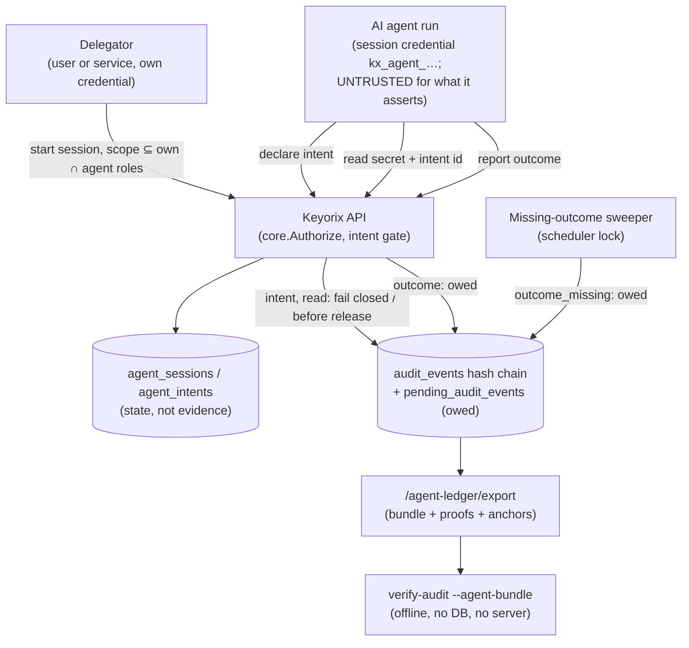

# Threat Model: Agent Evidence Ledger (design, not implemented)

> Part of [`docs/security/threat-models/`](README.md). Derived from
> [ADR-116](../../adr-116-agent-evidence-ledger.md) (Proposed) and
> [`../../design-rd-agent-ledger.md`](../../design-rd-agent-ledger.md).
>
> **Nothing in this document is implemented yet.** Every row is therefore a
> GAP. Its Evidence cell cites the test of the *existing* mechanism the design
> reuses (the owed-audit path, audit-before-disclosure, the offline verifier,
> the machine-identity controls). That test proves the reused part works
> today. It proves nothing about the ledger itself. When the implementation
> lands, each row names its own test and the GAP becomes a mitigation.

## 1. System context

## 2. Trust boundaries

| Actor | What they can do | What they can't do |
|---|---|---|
| Delegator | Start a session for an `agent` identity with a scope no wider than its own permissions and the agent's roles; end or revoke it | Delegate more than it holds; start a session inside an impersonation session |
| Agent run (holds the session credential) | Declare intents within the session scope; read the declared targets up to `max_uses`; report any outcome it likes | Read a value without a committed intent; read outside the intent's targets; write or alter a chain row; erase a missing-outcome row |
| Agent host (root on the machine running the agent) | Everything the agent run can do while the credential is valid; use a released value for anything | Extend the session beyond `expires_at`, or hide a release from the chain |
| DB-level actor / host admin | As in [`audit-chain.md`](audit-chain.md) §2 | As in `audit-chain.md` §2; a bundle anchored outside the host also constrains a host admin up to the anchor |
| Auditor with a bundle | Verify the records, proofs and pairing offline | Learn what the agent did with a value after release |

## 3. Threat table

| ID | STRIDE | Description | Mitigation | Evidence link | Residual risk / GAP |
|---|---|---|---|---|---|
| AGL-1 | Spoofing | **Forged agent identity: a stolen session credential.** An attacker who copies `kx_agent_…` from the agent host acts as the agent. | Design: the credential is valid for one session only, stored hashed, short-lived (default 1 h, cap 8 h), and dies when the session, the agent identity or the delegator stops being active (re-checked on every request, like machine tokens today); every use needs an open intent with `max_uses` (default 1). Reuses the machine-token revocation-on-cache-hit path. | `TestAuthentication_MachineTokenRevokedAfterCache_DeniedOnCacheHit` (`server/middleware/g18_cache_hit_revocation_test.go`) | **GAP: not implemented.** Within the TTL a thief holds what the agent holds. No proof of possession (DPoP, mTLS binding) is planned for the MVP. |
| AGL-2 | Elevation of privilege | **Forged delegation.** A caller starts a session that carries more authority than it holds, or a session outlives its delegator's authority. | Design: scope ⊆ delegator's effective permissions ∩ the agent identity's roles, derived from the ACTOR at session start, and re-derived at every intent; `agents.delegate` required; refused inside impersonation. Reuses the machine privilege-ceiling check. | `TestRequireMachinePrivilegeCeiling_NewIdentity_ActorLacksRolesAssign_Denied` (`internal/core/authz_guard_functions_test.go`); `TestAuthInterceptor_BlocksMachineTokenIssuanceWhileImpersonating` (`server/grpc/interceptors/auth_test.go`) | **GAP: not implemented.** The re-derivation at each intent is new code with no test yet. |
| AGL-3 | Repudiation / information disclosure | **Release without a durable intent.** A value is returned to the agent although its intent row is not committed (for example, the gate reads an intent from a transaction that later rolls back). | Design: the intent and its `agent.intent` row commit in one fail-closed transaction in an EARLIER request; the read gate checks the committed intent under a row lock; the read's own row is committed before the response (audit-before-disclosure). Reuses the fail-closed read audit and the max-reads counter discipline. | `TestGetSecret_PanicInAuditWriteFailsClosed` (`server/http/handlers/secrets_crud_goroutine_panic_test.go`); `TestMaxReads_ConcurrentNeverExceedsCap` (`internal/core/max_reads_enforce_test.go`) | **GAP: not implemented.** At `audit_durability: standard` an OS crash can lose an intent and its reads together after the release (ADR-116 decision D2). TLA+ invariant `NoReleaseWithoutDurableIntent` is planned (design note §4). |
| AGL-4 | Repudiation | **Intent without outcome.** The agent dies, is killed, or never reports, so the ledger shows a release with no follow-up. | Design: every intent is owed a terminal row. The agent's `agent.outcome`, or the sweeper's `agent.outcome_missing` at `not_after + grace`, goes through the owed path (effect and `pending_audit_events` record in one transaction, backfilled exactly once). Missing outcomes are counted, notified and listed by the verifier. | `TestRevocationAudit_EffectCommitsAndRowIsOwedNeverLost` (`internal/core/revocation_owed_audit_test.go`); `TestOwedAudit_RecordAndAppendRefused_RowsSurviveARestart` (`internal/core/owed_audit_late_queue_test.go`) | **GAP: not implemented.** Inherits the owed path's double-fault gap (pending table refusing plus a crash), which the TLA+ model found and #3656 addresses. A missing outcome is evidence of a gap, not of misuse. |
| AGL-5 | Repudiation / tampering | **Outcome without intent, or an outcome that lies.** A caller posts an outcome for an intent it does not own or that does not exist; or the agent reports `success` for something it did not do, or hides what it did with the value. | Design: the API refuses an outcome for an unknown or foreign intent (404 plus a denied row); the verifier marks any outcome whose intent is not earlier in the chain. Lies inside a valid outcome are NOT detectable: outcomes, digests and `agent_meta` are recorded and reported as agent-asserted. Reuses the best-effort denial row. | `TestSecretReadDenial_AuditWriteFailureKeepsTheRefusal` (`internal/core/secret_read_denial_test.go`) | **GAP: not implemented. Open, structural:** the ledger proves declaration, release and timing, not the agent's honesty. An attested runtime (D17) or downstream system logs are the only way to check an outcome. |
| AGL-6 | Spoofing / tampering | **Compromised agent host.** Root on the agent host reads the released value, re-uses the session credential, or exfiltrates the value for use outside the declared purpose. | Design: limit the blast radius. Short session TTL, one-use intents, targets bounded by the scope, an instant cut-off by revoking the session or the identity, and the `keyorix-mcp` read cap for MCP agents. Every release is recorded, so the scope of exposure after a compromise is known exactly from the ledger. | `TestServe_MaxReadsCapsGetSecret` (`internal/mcp/server_test.go`); `TestAuthentication_MachineTokenRevokedAfterCache_DeniedOnCacheHit` (`server/middleware/g18_cache_hit_revocation_test.go`) | **GAP: not implemented. Open, structural:** a value already released cannot be recalled; this is the same boundary as [`mcp-server.md`](mcp-server.md) MCP-3. |
| AGL-7 | Spoofing / repudiation | **Replay of an export.** An old bundle, or one made for someone else, is presented as current evidence; or a bundle from another deployment is passed off as this one's. | Design: the export writes `agent_ledger.exported` (fail closed) carrying the caller's nonce, and the bundle includes that row; `verify --expect-nonce` checks it; the report states coverage (head id, head time, anchors); `--anchor` with an earlier bundle checks consistency (tree mode). Reuses external-anchor cross-checking. | `TestAnchorStatus_InDBAnchorDoesNotMaskExternalMismatch` (`internal/auditverify/anchor_status_independence_test.go`) | **GAP: not implemented.** Without a nonce and an external anchor, a verifier can show only that a bundle is authentic, not that it is the latest. No deployment identifier exists yet. |
| AGL-8 | Tampering | **Chain truncation or selective omission in a bundle.** Ledger rows are deleted from the database's tail, or the exporter leaves inconvenient records out of a bundle. | Design: truncation is caught as today (checkpoints, external anchors, RFC 3161). In segment mode, omission is impossible (every row in range is present and linked). In tree mode, the per-session `seq` 1..`last_seq` must have no gaps. Records re-derive with the independent hash code, never the writer's. | `TestDifferential_TruncatedTail_CheckpointEnforced` (`internal/auditverify/differential_test.go`); `TestDifferential_ExternalAnchor_CatchesTruncation_EvenAfterLocalCheckpointErased` (`internal/auditverify/anchor_bundle_test.go`); `TestExhaustiveByteTamper_AuditRowDescription` (`internal/auditverify/tamper_exhaustive_test.go`); `TestDependencyGuard_NoCoreOrStorageImports` (`internal/auditverify/dependency_guard_test.go`) | **GAP: not implemented.** In tree mode an open session has no `last_seq`, so tail omission inside it is undetectable until it ends (reported INDETERMINATE). Against a host admin holding the DB and the checkpoint key, nothing after the last external anchor is proven (`audit-chain.md` §4). |
| AGL-9 | Repudiation | **Ledger rows still owed at export.** A bundle is verified while outcome rows are still in `pending_audit_events`, so it looks complete when it is not. | Design: the bundle carries the pending count; the verdict is INDETERMINATE while any agent row is owed, never VERIFIED (the same rule as unsettled degraded break-glass). | `TestVerify_OwedBreakGlassActivations` (`internal/auditverify/owed_break_glass_test.go`); `TestBreakGlassActivation_AuditFailure_CommitsDegradedWithOwedRecords` (`server/faultops/break_glass_degraded_owed_test.go`) | **GAP: not implemented.** The pending count in a bundle is a server claim; an offline verifier cannot check it against the live table. |

## 4. Residual risks, stated honestly

- **The agent is the witness for its own outcome (AGL-5).** The ledger does
  not and cannot prove what an agent did with a secret. It proves that the
  agent was authorised by a named delegator, declared a purpose and targets
  first, received exactly the recorded values, and then either reported or
  went silent. That is an accountability record, not a behaviour record.
- **A released value cannot be recalled (AGL-6).** The same structural limit
  as [`mcp-server.md`](mcp-server.md) MCP-3.
- **Every row is a GAP until the implementation lands.** The tests cited here
  cover the reused mechanisms; the plan in the design note (§7) names the test
  each row will cite instead.
