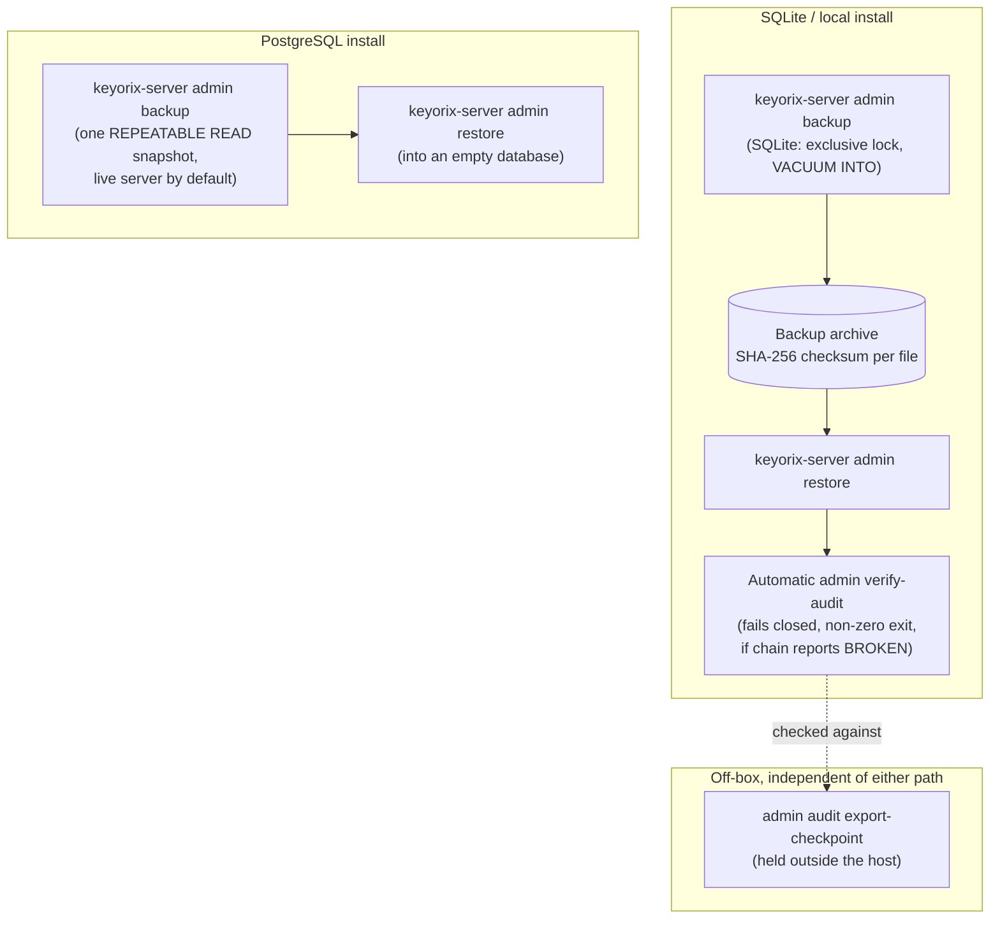

# Threat Model: Backup and Restore

> Part of [`docs/security/threat-models/`](README.md). Derived from
> [`../threat-model.md`](../threat-model.md) §5.3 and
> [ADR-108](../../adr-108-cli-server-split.md) decision B3. Covers both
> the SQLite path and the PostgreSQL path of the same Keyorix-native
> `admin backup`/`admin restore` commands; they differ in how the database
> snapshot is made, and this document says so plainly.

## 1. System context

`admin backup`/`admin restore` support both backends. SQLite takes the
exclusive database lock (stop the server first). PostgreSQL reads one
`REPEATABLE READ` snapshot beside the live server by default, or takes the
exclusive lock with `--exclusive`. A manual `pg_dump` plus a copy of the
key-material volume remains possible on PostgreSQL but is not required.

## 2. Trust boundaries

| Boundary | What it protects against | What it doesn't |
|---|---|---|
| Archive checksum (SHA-256 per file) | **Corruption** — proves the archive wasn't damaged in transit/storage | **Not tampering** — anyone who can edit the archive can recompute a matching checksum |
| `admin restore`'s automatic `verify-audit` | Restoring a tampered or truncated audit chain — fails closed (non-zero exit) if the chain reports BROKEN | A chain tampered *and* re-signed with a valid checkpoint (requires the checkpoint key, which requires KEK access — see [secret-storage-key-hierarchy.md](secret-storage-key-hierarchy.md)) |
| Off-box checkpoint export (`--anchor`) | The one check that constrains even a host admin who holds both the database and its checkpoint signing key | Nothing if the export itself is never taken or is also compromised |

## 3. Threat table

| ID | STRIDE | Description | Mitigation | Evidence link | Residual risk / GAP |
|---|---|---|---|---|---|
| BAK-1 | Information disclosure | A stolen backup (dump or `admin backup` archive), or a stolen key-material volume, exposes secret values. | Each alone is insufficient: the database is encrypted ciphertext under a DEK wrapped by the KEK; the key-material volume is useless without the database it wraps keys for. | [secret-storage-key-hierarchy.md](secret-storage-key-hierarchy.md) | **Both together, plus the master passphrase** (file-KEK install) is a complete offline compromise, equivalent to host root. A KMS/HSM-backed install additionally requires the external KMS boundary, so a stolen pair alone is *not* sufficient there. |
| BAK-2 | Tampering | A restored archive was modified after backup, not merely corrupted. | The SHA-256 checksum only proves the archive wasn't **corrupted** — it does not prove it wasn't **tampered with** (anyone who can edit the archive can recompute a matching checksum). `admin restore` runs `admin verify-audit` automatically and fails closed (non-zero exit) if the chain reports BROKEN. | ADR-108 §B3 | A chain tampered *and* re-signed with a valid checkpoint would pass — requires the checkpoint key, which requires KEK access (see [secret-storage-key-hierarchy.md](secret-storage-key-hierarchy.md)). The off-box checkpoint export (`--anchor`) is the check that constrains even that actor. |
| BAK-3 | Information disclosure | The backup archive itself carries no encryption layer beyond what the wrapped DEK already provides. | None beyond the DEK/KEK analysis in BAK-1 — stated as a real limitation, not papered over. | `../threat-model.md` §5.3 | **Open.** No Keyorix-native artifact-level encryption exists beyond the wrapped DEK; a stolen archive's confidentiality reduces entirely to BAK-1's analysis. |
| BAK-4 | Availability | On PostgreSQL, a backup taken while the server runs could pair a database snapshot with key files that changed meanwhile. | `admin backup` reads one `REPEATABLE READ` snapshot, bundles the key-material files in the same archive, and fails without leaving an archive if the key files change during the run; `--exclusive` takes the exclusive lock instead. | ADR-108 §B3; `docs/SELF_HOSTING.md` §5 | An operator who skips `admin backup` for a hand-rolled `pg_dump` + key-volume copy has no Keyorix tooling checking both halves were taken together. |

## 4. Residual risks, stated honestly

- **Backend moves:** a current (v2) archive restores into either backend,
  which is how a SQLite install moves to PostgreSQL; see
  [SELF_HOSTING.md "Moving from SQLite to Postgres"](../../SELF_HOSTING.md#moving-from-sqlite-to-postgres)
  and [`docs/design-b3-backup-v2.md`](../../design-b3-backup-v2.md). A legacy
  v1 (SQLite-only) archive restores only into SQLite.
- **Archive confidentiality** is BAK-3 and applies to both backends
  identically; see `../threat-model.md` §5.3.
