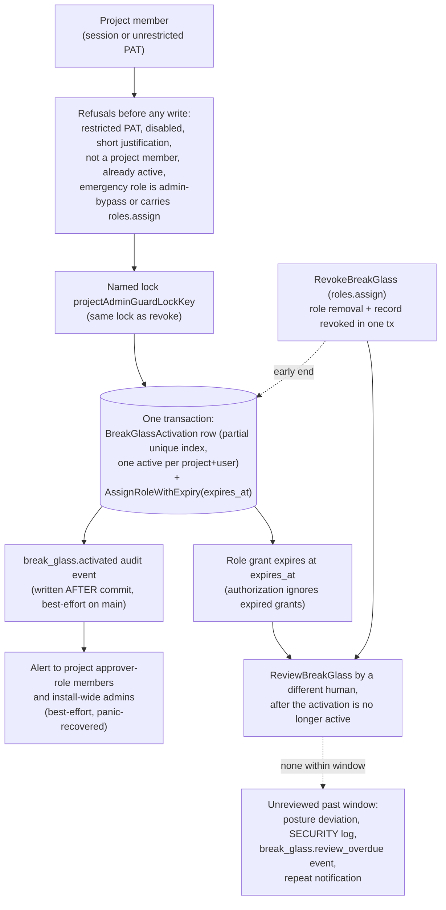

# Threat Model: Break-glass (self-service emergency access)

> Part of [`docs/security/threat-models/`](README.md). Narrows
> [`../threat-model.md`](../threat-model.md) to the self-service,
> time-bound emergency role grant (`POST /projects/{id}/break-glass`,
> ADR-112). This is *not* the offline admin recovery path
> (`keyorix-server admin recover-admin`, boundary B8), which is covered as
> AUTH-9 in [authentication.md](authentication.md).
>
> Evidence cells name a function or file and the test that proves it. A
> mitigation with no proving test on `main` is written as a **GAP**.
> `TestThreatModelEvidence_CitedFilesAndTestsExist` (`internal/threatmodelcheck`)
> checks that every cited path and `Test` function exists; it does not
> check that the test proves the mitigation.

## 1. System context

Break-glass is off by default (`break_glass.enabled: false`). When on, a
member of a project can grant themselves one configured, contained
emergency role on that project, for a bounded time, with a written
justification. It is deliberately not gated by RBAC (the point is access
the caller lacks), so the controls are configuration, membership,
containment of the role, justification, audit, alert, expiry and an
independent after-the-fact review.

## 2. Trust boundaries

| Boundary | What crosses it | Enforcement |
|---|---|---|
| Member → emergency role | A role the caller does not hold, on one project | Policy gates in `ActivateBreakGlass`; role must not be an admin-bypass role and must not carry `roles.assign` |
| Impersonation session → grant | A durable, time-bound grant attributed to the impersonated user | `BlockWhenImpersonating` on activation and review routes |
| Restricted PAT → owner's privileges | A token narrowed below its owner escalating the owner | `ErrRestrictedPATCannotBreakGlass`, checked first in core |
| Activator → reviewer | The record that proves the activation was checked | `ReviewBreakGlass`: human, not the activator, not still active, once |
| Core → audit log / notifier | The evidence that the grant happened | Audit write after commit; notification fan-out; both best-effort on `main` |

## 3. Threat table

| ID | STRIDE | Description | Mitigation | Evidence link | Residual risk / GAP |
|---|---|---|---|---|---|
| BG-1 | Elevation of privilege | Break-glass is enabled by accident or used when it is off. | Disabled by default; `ActivateBreakGlass` refuses with a typed `ErrBreakGlassDisabled` (HTTP 403 `BreakGlassDisabled`) and says which key turns it on. A justification of at least 10 characters after trimming is required. | `internal/core/break_glass.go` `ActivateBreakGlass`; `TestActivateBreakGlass_DisabledAndJustificationRequired`; `TestActivateBreakGlass_RejectsWhitespaceOnlyAndTooShortJustification`; `TestActivateBreakGlass_DisabledCarriesTypedCode` | The justification is free text; its length is checked, not its truth. The review (BG-7) is the control for that. |
| BG-2 | Elevation of privilege | A user who is not on the project (for example one holding only the install-wide baseline role) grants themselves the emergency role on any project. | Eligibility is `IsProjectMember`, which requires a role scoped to this project (directly or via a group) and excludes global roles. | `internal/core/break_glass.go` `ActivateBreakGlass`; `TestActivateBreakGlass_RejectsNonMember`; `TestActivateBreakGlass_RejectsGlobalOnlyAffiliation` | There is no minimum tenure: a user added to the project seconds ago can activate (noted in the code). Accepted: an emergency path that waits fails when it is needed. |
| BG-3 | Elevation of privilege | The emergency role is itself a vehicle for permanent or install-wide access: it is an admin-bypass role, or it carries `roles.assign` (which also gates machine-token issuance), so the holder mints access that outlives the expiry. | The role is resolved by name and refused if it is flagged admin-bypass (structural flag, not a name list) or if its permission set contains `roles.assign`. | `internal/core/break_glass.go` `ActivateBreakGlass`; `TestActivateBreakGlass_RejectsRoleAssignEmergencyRole`; `TestActivateBreakGlass_RejectsInstallAdminEmergencyRole` | The check runs at activation. A role's permissions can be edited afterwards by someone who can already edit roles, and a live grant then carries the new permission until it expires. Accepted: that editor is an administrator. Revoke re-runs the last-admin guard (BG-9). |
| BG-4 | Elevation of privilege / persistence | The grant never expires, is renewed indefinitely, or two activations race and the second keeps the role. | Expiry is `expires_at` on the role grant itself, capped at the effective ceiling (`MaxTTL`, falling back to the default TTL when unset, so an unconfigured ceiling cannot make an unbounded grant). One active activation per (project, user) is enforced by a partial unique index; a TTL-lapsed row is reconciled before a new insert. An expired grant denies authorization. | `internal/core/break_glass.go` `breakGlassTTLs`; `TestActivateBreakGlass_CapsTTL`; `TestActivateBreakGlass_UnsetMaxTTLFloorsToDefault`; `TestBreakGlass_ExpiredGrantDeniesAuthorization`; `TestActivateBreakGlass_RejectsConcurrentReactivation`; `TestCreateBreakGlassActivation_ConcurrentRaceYieldsExactlyOneWinner`; `TestBreakGlassActiveIndex_CreatedByMigration` | A member can re-activate once the previous grant has expired or been revoked; the number of activations is bounded only by the review process (BG-7), not by a rate. |
| BG-5 | Tampering | Activation and revoke interleave so the emergency role stays live while the record reads `revoked` (or the record exists with no role). | Record insert and role grant run in one transaction under the same named lock the revoke takes; revoke removes the role and marks the record in one transaction under that lock, and an "already gone" role removal is not an error. | `internal/core/break_glass.go` `activateBreakGlassLocked`, `RevokeBreakGlassActivationAtomic`; `TestActivateBreakGlass_InsertAndGrantShareTheRevokeLock`; `TestRevokeBreakGlass_StillTakesTheSameLock`; `TestActivateBreakGlass_FailedGrantLeavesNoActivationRecord`; `TestCTAReview_BreakGlassActivate_vs_Revoke_CrossReplicaPostgres` (Postgres-gated); `TestRevokeBreakGlassActivationAtomic_PostgresTransaction_GenuineFailureRollsBackBoth` (Postgres-gated) | None identified on the grant / record pair. |
| BG-6 | Repudiation | **Audit.** An activation is not recorded, or the record is lost when the audit subsystem is failing at the moment of activation. | Two records exist: the `BreakGlassActivation` row (durable, committed with the grant, queryable per project) and the audit rows `role.assigned` and `break_glass.activated` (hash-chained). When the audit log refuses the rows, the activation is not left unrecorded (BREAKGLASS-OWED-1, #3420): `activateBreakGlassDegraded` commits, in one transaction, a degraded activation with a forced short expiry, the grant with that same expiry, and a `pending_audit_events` record of each refused audit row linked to the activation; `BackfillPendingAuditEvents` later writes them into the chain with their original event times and settles the activation, and the admin banner lists unsettled activations. If the owed record cannot be committed either, nothing commits and the activation is refused with `ErrBreakGlassUnrecordable` (HTTP 503, gRPC Unavailable) pointing at the offline `recover-admin` procedure. A panic in either write is treated as a failed commit. | `internal/core/break_glass.go` `ActivateBreakGlass`, `activateBreakGlassDegraded`; `TestActivateBreakGlass_GrantsTimeBoundRole`; `TestActivateBreakGlass_StillAuditedWithGlobalAdminAlert`; `TestBreakGlass_NormalPathUnchanged`; `TestBreakGlass_AuditRefusedCommitsDegradedWithOwedRecord` (audit error, effect-then-error, panic and hang, then backfill and a valid chain); `TestBreakGlass_AuditAndOwedRecordRefusedIsRefused`; `TestBreakGlass_CrashNeverLeavesAnUnrecordedActivation`; `TestBreakGlass_DegradedTTLNeverLongerThanNormal`; `TestBreakGlass_AttackerMakesAuditUnwritable`; `TestBreakGlass_AuditChainLockHeldGoesDegraded_Postgres` | While degraded, the activation has a shorter expiry than a normal one and its post-activation review is mandatory; the audit rows are owed, not yet in the chain, until the backfill runs. If the database itself is failing, break-glass is refused and recovery is the offline `recover-admin` procedure. |
| BG-7 | Repudiation / elevation of privilege | The activator closes out their own activation, or a puppet identity does, so no independent person ever looks at it. | `ReviewBreakGlass` refuses: an unattributable reviewer (machine, local CLI), the activator, a still-active activation, a note under 10 or over 2000 characters, a second review. The review route requires `roles.assign` and is blocked while impersonating. Overdue reviews are a posture deviation (`emergency-access` control goes to Gap), a periodic `SECURITY:` log line, one `break_glass.review_overdue` audit event per pass and a repeated notification to the project's admins. Activation is never blocked by a pending review (decided). | `internal/core/break_glass.go` `ReviewBreakGlass`, `RunBreakGlassReviewReminder`; `TestReviewBreakGlass_RefusesSelfReview`; `TestReviewBreakGlass_RefusesUnattributableReviewer`; `TestReviewBreakGlass_RefusesWhileStillActive`; `TestBreakGlassActivation_HasNoApproverField`; `TestImpersonation_BreakGlassReviewBlocked`; `TestRunBreakGlassReviewReminder_WarnsAndAuditsOncePerPass`; `TestAccumulateBreakGlassPosture_CountsUnreviewedPastTheWindow` | **Single-administrator deployments cannot have an independent review**: the posture report flags it (`TestAccumulateBreakGlassPosture_SingleAdminDeploymentFlagsIndependentReviewImpossible`) but cannot fix it. A reviewer who is a colluding second person is out of scope. |
| BG-8 | Spoofing / elevation of privilege | **Notification recipients.** The alert reaches nobody, the wrong people, or is lost silently. | `projectAdminRecipients` resolves project approver-role members **and** install-wide admins (user grants and group-inherited grants, de-duplicated, active accounts only). A failure to list members is returned and logged as `SECURITY:`; recipients that were resolved are still notified; a panic in the fan-out is recovered and audited as `break_glass.notify_panicked`. A notification failure never fails the activation. | `internal/core/notifications.go` `projectAdminRecipients`; `TestActivateBreakGlass_NotifiesGlobalAdmin`; `TestActivateBreakGlass_NotifiesGroupInheritedGlobalAdmin`; `TestActivateBreakGlass_DedupesAdminWithBothScopes`; `TestNotifyBreakGlassAdmins_PanicInNotifyFanOut_StillReturnsNilAndAudits`; `TestNotifierRecipients_NoDirectProjectMemberFanOut` | Delivery is best-effort: a notifier outage is a detection-latency gap, not a control failure, because the grant is audited and listed regardless (subject to BG-6). A project with no approver-role member and no install-wide admin alerts nobody. |
| BG-9 | Denial of service / tampering | Revoking an emergency grant strips the project of its last administrator, or a TTL-lapsed row blocks a legitimate revoke. | `RevokeBreakGlassActivationAtomic` runs the last-project-admin guard and the removal under the same named lock; revoke is refused only for an already-revoked row, never because of a clock-derived `expired` state; a genuine role-removal failure aborts the revoke rather than recording it as done. | `internal/core/break_glass.go` `RevokeBreakGlass`; `TestRevokeBreakGlass_NotBlockedByExpiredState`; `TestRevokeBreakGlass_GenuineRoleRemovalFailureAbortsRevoke`; `TestRevokeBreakGlass_ConcurrentRevokesOnlyOneWins`; `TestConcurrency_RevokeBreakGlassActivationAtomic_TOCTOU_Deterministic` | None identified. |
| BG-10 | Elevation of privilege | **PAT-restricted callers.** A PAT created with a permission or project restriction activates break-glass and so escalates its owner beyond the restriction. | `ActivateBreakGlass` checks the PAT restriction first, before configuration or membership, and refuses with `ErrRestrictedPATCannotBreakGlass` on any restricted PAT. Listing is also filtered: a restricted PAT sees its owner's own rows only when it could have `roles.read` on the project. | `internal/core/break_glass.go` `ActivateBreakGlass`; `TestPATRestriction_RestrictedPATCannotActivateBreakGlass`; `TestListBreakGlassActivationsForCaller_PATRestriction`; `TestBreakGlassOwnList_PATRestriction` | None identified. An unrestricted PAT can activate on behalf of its owner, as the owner's session can. |
| BG-11 | Elevation of privilege | An admin impersonating a user activates break-glass, minting a durable grant attributed to the impersonated user that outlives the impersonation. | `BlockWhenImpersonating` on both the activation and the review routes. | `server/http/router.go` break-glass routes; `TestImpersonation_BreakGlassBlocked`; `TestImpersonation_BreakGlassReviewBlocked` | None identified. |
| BG-12 | Information disclosure | A member listing their own activations learns who reviewed or revoked them, the reviewer's note, or other members' activations. | `ListBreakGlassActivationsForCaller` returns the whole project only to a `roles.read` holder; otherwise only the caller's own rows with the reviewer, note and revoker identities stripped (`redactBreakGlassForOwnView`); a non-member, a machine without `roles.read`, and an authorization lookup failure all get the same refusal. | `internal/core/break_glass.go` `ListBreakGlassActivationsForCaller`; `TestListBreakGlassActivationsForCaller_OwnViewRedactsAdminFields`; `TestBreakGlassOwnView_RedactsEveryAdminField`; `TestBreakGlassOwnList_CrossProjectAndOutsiders` | None identified. |

## 4. Residual risks specific to this component

- **The audit rows can be late (BG-6).** The grant is recorded in the
  `BreakGlassActivation` table either way, so the activation is never
  invisible. While the audit log refuses writes the activation is
  degraded (short expiry, mandatory review) and its audit rows are owed
  until the backfill writes them into the chain. If the database cannot
  record even that, break-glass is refused and the offline
  `recover-admin` path (AUTH-9) is the documented last resort.
- **One person can activate and the review is after the fact.** This is
  the ADR-112 design (an emergency path that needs a second person fails
  exactly when it is needed). A deployment with one administrator has no
  independent reviewer; the posture report says so.
- **Containment is checked at activation, not continuously (BG-3).**
- System-wide residuals (the authentication cache window, clock skew
  across replicas for `expires_at`) are not re-derived; see
  [authentication.md](authentication.md) and [ha-consistency.md](ha-consistency.md).
