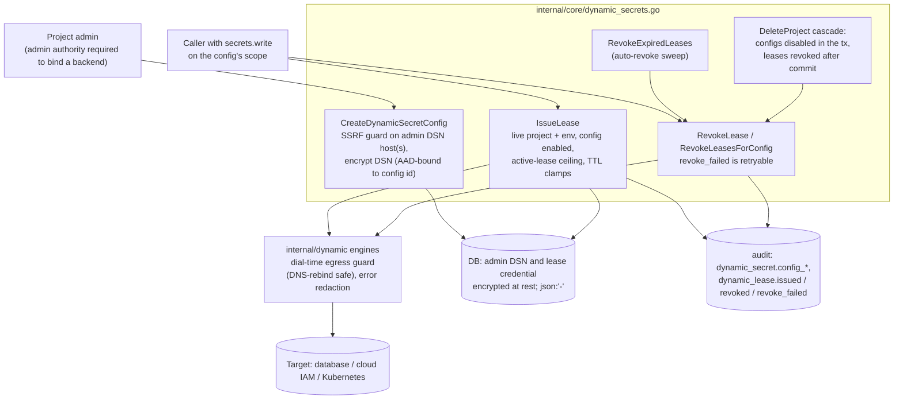

# Threat Model: Dynamic secrets and leases

> Part of [`docs/security/threat-models/`](README.md). Narrows
> [`../threat-model.md`](../threat-model.md) to on-demand credentials
> (ADR-035): an operator registers a target (`DynamicSecretConfig`: a
> database, a cloud IAM role, a Kubernetes cluster), callers issue
> short-lived leases that mint a credential on that target, and an
> auto-revoke sweep drops them at expiry. Keyorix holds an **administrative
> credential for the target** (the admin DSN) so that it can mint and drop
> roles; that standing credential is what makes this component sensitive.
> The static-credential rotation connectors are in
> [connectors.md](connectors.md); the encryption envelope is in
> [secret-storage-key-hierarchy.md](secret-storage-key-hierarchy.md).
>
> Evidence cells name a function or file and the test that proves it. A
> mitigation with no proving test on `main` is written as a **GAP**.
> `TestThreatModelEvidence_CitedFilesAndTestsExist` (`internal/threatmodelcheck`)
> checks that every cited path and `Test` function exists; it does not
> check that the test proves the mitigation.

## 1. System context

## 2. Trust boundaries

| Boundary | What crosses it | Enforcement |
|---|---|---|
| Operator → Keyorix (config) | The admin DSN: a standing administrative credential for the target | Admin authority to bind; encrypted at rest with an AAD bound to the config; never in a response (`json:"-"`) |
| Keyorix → target | Network connections to an operator-chosen host | Host check at register time; dial-time resolve-then-dial guard against private, loopback and link-local addresses (IMDS included), unless the operator opts in |
| Caller → target (via lease) | A short-lived credential minted on the target | TTL clamps, active-lease ceiling, expiry enforced by the target where it supports it, otherwise by the sweeper |
| Project lifecycle → leases | A project delete must stop credential issuance and end live leases | Config disable in the delete transaction; post-commit lease revoke |

## 3. Threat table

| ID | STRIDE | Description | Mitigation | Evidence link | Residual risk / GAP |
|---|---|---|---|---|---|
| DYN-1 | Information disclosure | **Admin DSN at rest.** The target's administrative connection string is read from the database, a backup, or an API response. | `CreateDynamicSecretConfig` encrypts the DSN (after the row id exists, so the ciphertext is bound to `DynamicSecretConfigAAD(id, project, environment)`); the model fields are `json:"-"`, so no API response carries it; a ciphertext copied to another config fails to decrypt. | `internal/core/dynamic_secrets.go` `CreateDynamicSecretConfig`; `TestDynamicSecrets_ConfigEncryptsAdminDSN`; `TestDynamicSecrets_AdminDSNTransplantBetweenConfigsFailsToDecrypt` | The DSN is decrypted in process memory on every issue and revoke, so a compromise of a running server yields a target-administrator credential for every registered backend (same class as the in-process residual in [secret-storage-key-hierarchy.md](secret-storage-key-hierarchy.md)). Register the narrowest administrative role the creation template needs. When encryption is not wired, the bytes pass through unencrypted (the `encryptAuthSecret` disabled mode). |
| DYN-2 | Elevation of privilege | A user with only `secrets.write` binds a backend and so obtains standing access to mint live credentials, or points a config of project A at project B's environment. | Binding requires admin authority on the project (`requireDynamicSecretAdminAuthority`); the environment must belong to the project; a duplicate name in the same scope is refused. | `internal/core/dynamic_secrets.go` `requireDynamicSecretAdminAuthority`; `TestDynamicSecrets_CreateConfig_RequiresAdminAuthority`; `TestDynamicSecrets_CreateConfig_RejectsCrossProjectEnvironment`; `TestDynamicSecrets_CreateConfig_DuplicateNameRejected` | **By design:** issuing, renewing and revoking a lease, and enabling or disabling a config, need only `secrets.write` at the config's scope (router). Anyone who holds it can mint credentials against every enabled config in that scope. |
| DYN-3 | Spoofing / information disclosure | **SSRF.** An operator uses Keyorix as a proxy to reach private services at its network position, including the cloud metadata endpoint, by registering an admin DSN (or Kubernetes API server) that points there; or re-points a public name at a private address after registration (DNS rebinding). | Two layers. Register time: every host of a (possibly multi-host) DSN, including IPv6 zone-qualified literals and names that resolve to a private address, is refused unless `dynamic_secrets` private-network opt-in is set. Dial time: each engine dials through `netutil.Dialer` with the same disallow policy and a pinned, validated IP, and the driver's own lookup is routed through the same resolver, so the check cannot be bypassed between resolve and connect. A source scan fails the build if an engine constructs an unguarded connection. | `internal/core/dynamic_secrets.go` `validateAdminDSNHost`; `TestValidateAdminDSNHost_PrivateLiteralIPRejected`; `TestValidateAdminDSNHost_ZoneQualifiedLinkLocalRejected`; `TestDynamicSecrets_CreateConfig_SSRFGuardRejectsPrivateIP`; `TestDynamicSecrets_CreateConfig_SSRFGuardRejectsKubernetesPrivateAPIServer`; `TestDynamicSecrets_CreateConfig_SSRFGuardBypassed`; `TestPostgresEngine_Issue_DialTimeRefusesDNSRebind`; `TestPostgresEngine_Revoke_DialTimeRefusesDNSRebind`; `TestMySQLEngine_Issue_DialTimeRefusesDNSRebind`; `TestDialer_DialContext_DNSRebind`; `TestNoUnguardedEgress`; `TestDynamicSecrets_RevalidateAdminDSN_IssueAndRevoke`; `TestDynamicSecrets_RenewRevalidatesAdminDSN` | The register-time check skips a host it cannot resolve and a DSN format it cannot parse (`TestValidateAdminDSNHost_UnresolvableHostAllowed`, `TestValidateAdminDSNHost_UnrecognisedDSNAllowed`); the dial-time guard is what covers those. The opt-in for private-network targets is an install-wide switch: an operator who sets it accepts that any admin who can bind a backend can reach the private network. The decrypted DSN is re-checked at issue, renew and revoke time (`revalidateAdminDSN`, for configs created before the guard or before the operator tightened the switch); the three tests above create a config against the metadata address while the switch is on, tighten it, and assert each call is refused with the engine never dialled. |
| DYN-4 | Denial of service / elevation of privilege | A lease lives longer than intended, or a caller mints unbounded real roles on the target. | TTL is the override, else the config default, else 1h, clamped to the config's `MaxTTLSeconds` and to an install-wide ceiling (default 90 days), with an overflow bound before the multiplication; an active-lease ceiling per config counts `revoke_failed` leases; for a cloud engine the stored expiry is the provider's actual granted expiry. | `internal/core/dynamic_secrets.go` `dynamicTTL`, `IssueLease`; `TestDynamicSecrets_MaxTTLClampsIssue`; `TestDynamicSecrets_InstallWideMaxLeaseTTLClampsIssue`; `TestDynamicSecrets_IssueRejectsOverflowingTTLSeconds`; `TestDynamicSecrets_MaxActiveLeasesCeiling`; `TestDynamicSecrets_MaxActiveLeasesCeiling_CountsRevokeFailed`; `TestDynamicSecrets_ExpiresAtUsesProviderActualExpiryWhenSurfaced`; `TestDynamicSecrets_IssueRefusesNoNativeExpiryBackendWithoutSweeper`; `TestDynamicSecrets_RenewRefusesNoNativeExpiryBackendWithoutSweeper`; `TestDynamicSecrets_IssueLease_DisabledConfigMintsNothing` | The active-lease ceiling is a soft cap: two concurrent issues can both pass the count (noted in the code). A backend with no native expiry (MySQL, MongoDB, Redis) relies on the sweeper to enforce the TTL, so issue and renew both refuse while `dynamic_secrets.sweep_enabled` is false (the issue test runs the production MySQL, MongoDB and Redis engines; the renew test uses the fake engine with native expiry off; both assert nothing is minted or extended); a disabled config mints nothing. |
| DYN-5 | Repudiation / information disclosure | A revoke is reported as done when the credential is still live, or the record of it is lost. | `RevokeLease` marks `revoke_failed` (retryable by the sweep, `RevokeLeasesForConfig` and a manual retry) when the target drop fails; records only the revocation columns; fails closed when the revocation row no longer exists or when the audit write failed after a successful drop; bulk revoke returns an error if any lease did not fully complete; driver errors are redacted before logging. | `internal/core/dynamic_secrets.go` `RevokeLease`; `TestDynamicSecrets_RevokeFailureMarksLease`; `TestDynamicSecrets_RevokeFailedIsRetryable`; `TestDynamicSecrets_RevokeLeasesForConfigReportsPersistentFailure`; `TestDynamicSecrets_RevokeLease_RevocationRecordNoMatchFailsClosed`; `TestDynamicSecrets_RevokeLease_AuditWriteFailureIsNotSwallowed`; `TestNoUnsanitizedDriverErrorReachesLog` | **Ephemeral backends (AWS STS, Azure, GCP, Kubernetes unless the config sets `revocable`) cannot invalidate a credential early.** "Revoke" marks the lease dead in Keyorix only, the credential stays valid until the provider's own expiry, and the audit event says so (`TestDynamicSecrets_RevokeEphemeralBackendAuditsHonestly`). A crash between the target mint and the lease insert leaves an orphan role invisible to every list and sweep path (documented in `IssueLease`; only a log line is left). |
| DYN-6 | Elevation of privilege | **Lease versus project delete.** A deleted project keeps minting credentials (a principal still holding a role scoped to it), its live leases survive, or restoring the project silently re-enables minting. | `deleteProjectCascade` disables every config of the project in the delete transaction, so `IssueLease` and `RenewLease` refuse from the instant it commits; after commit, `DeleteProject` revokes every active and `revoke_failed` lease (best-effort, a panic is recovered and audited as `dynamic_secret.project_cascade_failed`); a lease cannot be created against a config disabled after the check (storage refuses); `RestoreProject` does not re-enable configs, and enabling one requires a live project; config writes are column-scoped so a classify cannot undo the kill switch. | `internal/core/catalog.go` `DeleteProject`, `revokeProjectDynamicSecretLeases`; `TestDeleteProject_RealStorage_DisablesDynamicSecretConfigsAndRevokesLeases`; `TestDeleteProject_CascadePanicInRevokeLeases_StillReturnsNil`; `TestCreateDynamicSecretLease_ActiveRefusedOnDisabledConfig`; `TestSetDynamicSecretConfigEnabled_RefusesUnderDeletedProject`; `TestDynamicSecretWrites_AreColumnScoped` | The post-commit revoke is real network I/O to the target and is best-effort: if the target is unreachable, or the process stops between the commit and the revoke, the lease stays `active` or `revoke_failed` until the sweep retries it or the credential's own TTL ends it. Nothing blocks the project delete on it. |
| DYN-7 | Tampering | Concurrent classify / disable / renew / revoke races leave a config enabled that an administrator disabled, or a lease both renewed and revoked. | Disable is a conditional transition that refuses a lost race rather than overwriting; classification and DSN writes touch only their own columns, so they cannot undo the kill switch. | `internal/storage/store/store_s3_test.go` `TestTransitionDynamicSecretConfigDisabled_ClosesRace`; `TestTransitionDynamicSecretConfigDisabled_DoesNotClobberConcurrentDSNRotation`; `TestSetDynamicSecretConfigEnabled_LostRaceReportedCleanly`; `TestSetDynamicSecretConfigAdminDSN_LeavesDisabledAlone`; `TestCTAReview_ClassifyDynamicSecretConfig_vs_KillSwitch_CrossReplicaPostgres` (Postgres-gated); `TestCTAReview_RenewLease_vs_RevokeLease_CrossReplicaPostgres` (Postgres-gated) | None identified. |
| DYN-8 | Information disclosure | The issued credential is persisted or logged in clear, or readable again after issue. | The credential is returned once; the stored form is encrypted with an AAD bound to the lease and config; the lease model's credential fields are `json:"-"`; driver errors are redacted before they reach a log line or a lease row. | `internal/core/dynamic_secrets.go` `IssueLease`; `TestDynamicSecrets_IssueListRevoke`; `TestRedactSensitive_URLUserinfo`; `TestRedactSensitive_KeyValueCredentials`; `TestNoUnsanitizedDriverErrorReachesLog` | The one response that carries the plaintext is the issue response itself; whoever calls issue sees it. The audit description names the lease id and config, never the credential. |

## 4. Residual risks specific to this component

- **The admin DSN is a standing credential for the target (DYN-1).** The
  trust placed in Keyorix is the trust placed in whoever can run code in
  the server process or read its key material.
- **Early revocation is not possible for cloud-IAM leases (DYN-5).** Plan
  incident response around the provider's own expiry, not around the
  revoke button.
- **Lease cleanup after a project delete is eventual (DYN-6).**
- **`secrets.write` is enough to mint (DYN-2).** Scope the role, not the
  config, if issuance should be limited.
- System-wide residuals (key hierarchy, in-process exposure) are not
  re-derived; see [secret-storage-key-hierarchy.md](secret-storage-key-hierarchy.md).
