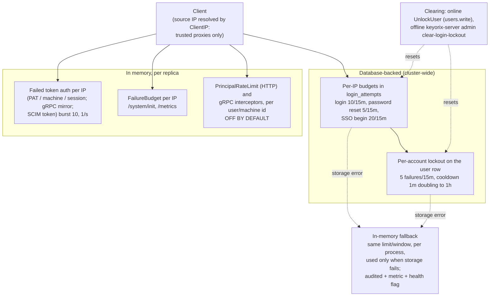

# Threat Model: Rate limits and login lockout

> Part of [`docs/security/threat-models/`](README.md). Narrows
> [`../threat-model.md`](../threat-model.md) to the controls that bound
> credential guessing and request volume: the per-IP login budget, the
> per-account lockout, the failed-token and static-secret budgets, the
> per-principal API limiters, and how each behaves when its storage fails.
> This document describes `main` as it is; the HTTP limiter code is owned
> by another session (HARDEN-HTTP-1) and this document does not propose
> changes to it. How a credential is verified is in
> [authentication.md](authentication.md).
>
> **Read the residual risk first:** the *login* budget and the *account
> lockout* are stored in the database and hold across replicas. Every other
> limiter in this list is **in memory and per replica**: its effective
> cluster-wide limit is the configured limit times the number of replicas,
> it resets on restart, and the per-principal API limiters are **off by
> default**.
>
> Evidence cells name a function or file and the test that proves it. A
> mitigation with no proving test on `main` is written as a **GAP**.
> `TestThreatModelEvidence_CitedFilesAndTestsExist` (`internal/threatmodelcheck`)
> checks that every cited path and `Test` function exists; it does not
> check that the test proves the mitigation.

## 1. System context

## 2. Trust boundaries

| Boundary | What crosses it | Enforcement |
|---|---|---|
| Network → server | Source address of an unauthenticated request | `ClientIP` honours `X-Forwarded-For` / `X-Real-IP` only from a configured trusted proxy; otherwise the TCP peer |
| Guess → credential check | An attempt that costs the attacker one of N | Budget slot reserved before the slow check; account counter updated under a row lock |
| Limiter → its storage | A count that cannot be read or written | Bounded in-memory fallback with the same limit; never fail open, never lock everyone out |
| Operator → lockout state | Lifting a refusal early | Offline command audits first and fails closed; online unlock needs `users.write` |

## 3. Threat table

| ID | STRIDE | Description | Mitigation | Evidence link | Residual risk / GAP |
|---|---|---|---|---|---|
| RL-1 | Spoofing | **Login budget (per IP).** Password, MFA, WebAuthn, refresh and setup-link guessing from one address is unbounded. | Every login-family route spends a slot of the `login` budget (10 failed attempts per 15 minutes per canonical IP) stored in `login_attempts`, so the limit holds across replicas. The slot is reserved before the credential check (concurrent requests cannot all read an unspent budget) and handed back when a session is delivered. IPv6 forms, a `:port` suffix and a reconnect do not change the key. A guard test fails if an auth route is not classified and budgeted. | `internal/core/rate_limit.go` `IsLoginRateLimited`, `ReserveLoginAttempt`, `CanonicalIP`; `TestRateLimit_BlocksAtBudgetAndExpiresWithWindow`; `TestRateLimit_CanonicalizesIPBeforeKeying`; `TestCanonicalIP`; `TestEveryAuthRoute_IsClassifiedAndBudgeted` | Per source IP only: an attacker with many addresses spends a budget per address, and the account lockout (RL-2) is the control for that case. Behind a proxy that is **not** listed in `trusted_proxies`, every client shares the proxy's address and one noisy client can exhaust the budget for all (RL-7). |
| RL-2 | Spoofing | **Account lockout.** Rotating source IPs defeats a per-IP budget; a correct password after the lock trips succeeds; a burst of concurrent guesses races past the counter. | On by default: 5 failures within 15 minutes lock the account for a cooldown that doubles per lockout from 1 minute to a 1 hour cap. State lives on the user row, updated in a transaction over a row-locked read, serialized per account; a correct password is refused while locked; the lock is re-checked immediately before a session is minted (also on failure of the check: fail closed). The counter clears only when the login is delivered, and a denial after the credential matched (a storage fault) costs the same as a wrong credential, so a correct guess is never cheaper. A correct password alone does not clear it when MFA is required. | `internal/core/login_lockout.go` `recordFailedLogin`, `recheckLoginLockFailClosed`, `LoginCompletion`; `TestLoginLockout_LocksAfterMaxAttempts`; `TestLoginLockout_BackoffGrowsAcrossLockouts`; `TestLoginLockout_WindowResetsStaleFailures`; `TestConcurrency_LoginLockout_MixedBurstCorrectPasswordAmongLockedNeverMintsExtra`; `TestLogin_PasswordOnlyDoesNotClearLockoutWhenMFARequired`; `TestClearLoginFailures_HasNoCallerBeforeAFallibleStep`; `TestVerifyMFALogin_FailedCodesFeedAccountLockout` | **Lockout is a denial-of-service lever by design:** anyone who can name an account can keep it locked by failing logins (about one burst per cooldown). The per-IP budget, the exponential cooldown cap and the admin unlock (RL-9) bound it; the only administrator being locked is what `clear-login-lockout` exists for. Lockout applies to password / second-factor logins only; PAT and machine-token guessing is bounded by RL-5. The code spends a dummy bcrypt comparison on the locked and unknown-user paths so their latency matches a wrong password; no test on `main` pins that timing, so it is a code behaviour, not a proven property. |
| RL-3 | Denial of service / spoofing | **A limiter's storage fails** (a database fault, or an attacker able to provoke one): fail-open removes the brute-force backstop, fail-closed locks every user out. | Neither. Every auth budget goes through one limiter (`auth_budget.go`); on a storage error it falls back to a bounded in-memory limiter with the same limit and window (at most 10,000 keys per budget, least recently used evicted), counts the stored and in-memory attempts together, holds the password-reset fallback to half the limit, divides each fallback limit by the configured replica count, caps resets per account, audits each fallback (`auth.rate_limit_error`), increments `keyorix_auth_rate_limit_fallback_total{budget}` and reports `AuthRateLimitDegraded` for the health endpoint. A keyed, once-retried write counts a lost acknowledgement exactly once. | `internal/core/auth_budget.go` `budgetLimited`, `budgetWriteKeyed`; `TestLoginBudgetFallback_StorageDownStillEnforcesTheLimit`; `TestAccountLockout_StateStorageDown_PasswordLoginStillLocks`; `TestAccountLockout_StoredAndFallbackFailuresAreSummed`; `TestAuthBudgetFallback_AuditedAndCountedPerBudget`; `TestAuthBudgetFallback_ReplicaDivisorScalesTheLimit`; `TestLoginBudgetFallback_BoundedUnderManyDistinctIPs`; `TestAuthBudgetStorage_OnlyThroughTheSharedLimiter`; `TestEveryAuthBudget_HoldsWithItsStorageDown` | **While on the fallback the limit is per process.** In an HA deployment each replica enforces its own copy; the effective cluster-wide limit is up to the limit per replica an attacker can reach, unless `security.auth_rate_limit_fallback.replicas` is set. Eviction of the bounded map can drop an account's in-memory lock (pinned by `TestAccountLockoutFallback_LockSurvivesUpToTheKeyBound`). The audit write for the fallback is itself best-effort; the metric exists for the case where it fails. |
| RL-4 | Denial of service | **Per-principal request volume.** One authorized principal hammers the endpoints that walk the whole deployment. | HTTP `PrincipalRateLimit` and the gRPC unary and stream interceptors apply a token bucket per user id or machine-identity id (source IP when unauthenticated, canonical, port-stripped); gRPC stream opens have their own bucket. This is a nuisance backstop, not an authorization control. | `server/middleware/rate_limit.go` `PrincipalRateLimit`; `server/grpc/interceptors/rate_limit.go` `GRPCRateLimitInterceptor`; `TestPrincipalRateLimit_EnforcesPerPrincipalBudget`; `TestPrincipalRateLimit_FallsBackToIPForUnauthenticated`; `TestGRPCRateLimitInterceptor_EnforcesPerPrincipalBudget`; `TestGRPCRateLimitInterceptor_IPFallbackIgnoresEphemeralPort`; `TestStreamRateLimitInterceptor_IndependentBudgetFromUnary` | **Off by default** (`server.http.ratelimit.enabled`, `server.grpc.ratelimit.enabled` are false; the server logs a warning) and, when on, **in memory and per replica**: N replicas allow N times the configured rate and a restart resets every bucket. Per-principal buckets mean a user with several credentials shares one budget and a principal cannot be throttled by someone else's traffic. |
| RL-5 | Spoofing | **Failed token authentication.** PAT, machine-token, session and SCIM-token guessing floods the auth path without bound (the per-principal limiters only run after authentication succeeds). | A per-IP budget on *failed* token authentications (burst 10, refilling at 1 per second) in the HTTP auth middleware and, as an independent copy, in the gRPC auth path; the SCIM token middleware records its failures against the same HTTP limiter and answers 429 with `Retry-After`. The sweep of idle entries is amortised. | `server/middleware/rate_limit.go` `recordTokenAuthFailure`; `server/grpc/interceptors/rate_limit.go` `recordGRPCTokenAuthFailure`; `TestIPFailureLimiter_StillEnforcesBudget`; `TestIPFailureLimiter_SweepAmortized`; `TestSCIMToken_ThrottlesRepeatedFailures`; `TestGRPCIPFailureLimiter_SweepEvictsOnlyIdleEntries`; `TestGRPCIPFailureLimiter_SweepAmortized` | **In memory and per replica**, like RL-4. The gRPC copy (`grpcIPFailureLimiter.allow`) sweeps once per `grpcPrincipalLimiterSweepEvery` failed attempts, not on every call (#3429, fixed in fc18b443f); `TestGRPCIPFailureLimiter_SweepAmortized` counts the sweeps by their effect and fails if the scan runs per call. |
| RL-6 | Spoofing | **Static-secret routes.** The bootstrap token (`POST /system/init`) and the metrics token (`GET /metrics`) have no account to lock out and can be guessed. | `FailureBudget` per client IP: a response with a failure status spends a unit (bootstrap: 5, refilling every 30 s; metrics: 10, every 6 s); successful responses cost nothing; the unit is reserved before the handler runs and given back on success, so a concurrent burst cannot run the check past the budget. | `server/middleware/failure_budget.go` `FailureBudget`; `server/http/failure_budgets.go`; `TestFailureBudget_RefusesAfterBurstOfFailures`; `TestFailureBudget_SuccessesCostNothing`; `TestFailureBudget_ConcurrentBurstBoundedByBudget` | In memory and per replica. A guessable operator-pinned bootstrap token is still guessable at the refill rate across replicas. |
| RL-7 | Spoofing | **A forged source address** lets an attacker choose their own per-IP bucket, or a shared proxy address collapses all clients into one. | `ClientIP` replaces trust-everything middleware: forwarding headers are read only when the TCP peer is in `server.http.trusted_proxies`; the chain is walked from the right to the first untrusted hop; with no trusted proxy configured the TCP peer is always used. | `server/middleware/client_ip.go` `ClientIP`; `TestClientIP_IgnoresHeaderWhenNoTrustedProxies`; `TestClientIP_IgnoresHeaderWhenPeerNotTrusted`; `TestClientIP_StopsAtFirstUntrustedHopFromRight`; `TestClientIP_HonorsHeaderFromTrustedProxy` | A deployment behind a load balancer that does not list it in `trusted_proxies` rate-limits the balancer, not the clients; a listed proxy that appends rather than overwrites headers is handled, one that is itself compromised is not. |
| RL-8 | Denial of service | Unauthenticated flooding of password-reset and SSO / SAML begin requests (mail-bombing, unbounded state rows). | Separate DB-backed per-IP budgets in the same table under their own key prefixes (password reset 5 per 15 minutes, SSO begin 20 per 15 minutes); the reset request is recorded on every call so the response does not reveal whether the address exists. | `internal/core/rate_limit.go` `IsPasswordResetRateLimited`, `IsSSOBeginRateLimited`; `TestRateLimit_SSOBegin_BlocksAtBudgetAndExpiresWithWindow`; `TestRateLimit_SSOBegin_SharesLoginAttemptTableButOwnBudget`; `TestPasswordResetBudget_HealthyKeepsTheFullLimit` | Per IP only; the per-account reset cap applies while the per-IP budget is on its fallback. |
| RL-9 | Repudiation / elevation of privilege | **Lockout clear audit.** A brute-force refusal is lifted early with no record of who did it or why. | The offline `keyorix-server admin clear-login-lockout` (host access) audits first and clears nothing if the audit write fails, then records `admin.login_lockout_clear_failed` if the clear fails after the intent was recorded; it validates both inputs before changing either. An automatic lock writes `account.locked` only after its transaction commits. | `server/admin/login_lockout.go` `performClearLoginLockout`; `TestClearLoginLockout_ClearsTheIPBudgetAndIsAudited`; `TestClearLoginLockout_ClearsTheAccountLockoutAndIsAudited`; `TestClearLoginLockout_AuditWriteFailureClearsNothing`; `TestClearLoginLockout_ClearFailureIsAuditedAsFailed`; `TestClearLoginLockout_RejectsBadInputBeforeChangingAnything` | **GAP #3428 (design decision, low):** the online `UnlockUser` (`POST /users/{id}/unlock`, `users.write`) clears the lockout first and writes `account.unlocked` afterwards through the best-effort audit writer, so a failed audit write leaves the lockout lifted with no record; `TestLoginLockout_UnlockUserClearsState` checks the state change, nothing asserts the audit under failure. It is also deliberately not ceiling-gated (documented in the code): a `users.write` holder can unlock a higher-privileged account, which grants no new access. |
| RL-10 | Tampering | The limiter table is wiped or poisoned (prune with an unbounded cutoff, a forged future timestamp that no sweep can ever remove). | `PruneLoginAttempts` clamps the cutoff to no later than `now - window` and audits the actor, count and cutoff whenever it removes rows; the relay path rejects a key that is not an IP (optionally with a known prefix) and a timestamp in the future. | `internal/core/rate_limit.go` `PruneLoginAttempts`; `TestPruneLoginAttempts_ClampsFutureBeforeToWindow`; `TestPruneLoginAttempts_AuditsActorRowCountAndCutoff`; `TestPruneLoginAttempts_NarrowerBeforeIsHonored` | None identified for the prune. |

## 4. Residual risks specific to this component

- **Most limiters are in memory and per replica.** Only the login /
  password-reset / SSO-begin budgets and the account lockout are shared
  through the database. The failed-token budgets (HTTP, gRPC, SCIM), the
  static-secret budgets and the per-principal limiters each keep their own
  state in each process: with N replicas the real limit is up to N times
  the configured one, and a restart or a rolling update resets it. Treat
  them as a nuisance backstop against a single noisy client, not as a
  cluster-wide guarantee. Put a rate limit at the load balancer for that.
- **The per-principal API limiters are off by default.** An install that
  has not enabled them has no request-volume control beyond the above.
- **During a database fault the login budget is per process too** (RL-3).
- **Lockout can be turned against a named account (RL-2).** That is the
  accepted price of binding the control to the account instead of the
  address.
- **Per-IP controls assume a correct `trusted_proxies` (RL-7).**
- System-wide residuals (the authentication cache window) are in
  [authentication.md](authentication.md); replica-clock behaviour is in
  [ha-consistency.md](ha-consistency.md).
