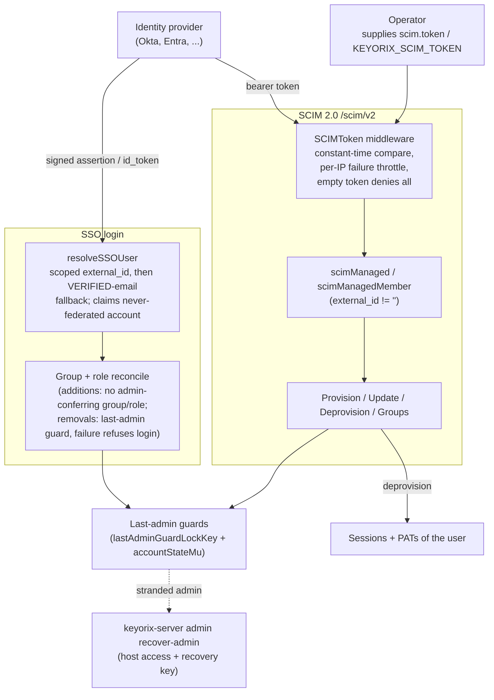

# Threat Model: SCIM provisioning and SSO-managed accounts

> Part of [`docs/security/threat-models/`](README.md). Narrows
> [`../threat-model.md`](../threat-model.md) to accounts whose lifecycle an
> identity provider drives: the SCIM 2.0 endpoints (`/scim/v2`, static
> bearer token), SSO login that links or JIT-provisions an account (OIDC and
> SAML), IdP group / role reconciliation at login, and the install's
> last-administrator posture when the administrator is SSO-managed. How an
> SSO assertion itself is verified is AUTH-4 / AUTH-5 in
> [authentication.md](authentication.md); this document starts after it.
>
> Evidence cells name a function or file and the test that proves it. A
> mitigation with no proving test on `main` is written as a **GAP**.
> `TestThreatModelEvidence_CitedFilesAndTestsExist` (`internal/threatmodelcheck`)
> checks that every cited path and `Test` function exists; it does not
> check that the test proves the mitigation.

## 1. System context

## 2. Trust boundaries

| Boundary | What crosses it | Enforcement |
|---|---|---|
| IdP / operator → SCIM endpoints | A provisioning credential that creates, edits and removes accounts | One operator-supplied static bearer token (no per-request identity); constant-time compare; per-IP throttle; boot-time length check |
| SCIM token → account | A target numeric id taken from the URL path | `scimManaged` ownership check (fresh, lock-guarded read), checked before any collision probe; last-admin guard |
| IdP → local role / group state | Group names and role mappings asserted at each login | Additions may not confer admin; removals go through the last-admin guards; any failed step refuses the login |
| SSO identity → existing account | An email address asserted by an IdP | Verified email only (SAML needs the provider's `TrustAssertedEmail`); an account already bound to another provider is refused |
| Install ↔ its last administrator | Deactivation by SCIM or by an IdP revocation | Last-admin guard; offline `recover-admin` as the documented way back |

## 3. Threat table

| ID | STRIDE | Description | Mitigation | Evidence link | Residual risk / GAP |
|---|---|---|---|---|---|
| SCIM-1 | Spoofing | The SCIM bearer token is guessed or brute-forced. | `SCIMToken` compares in constant time, answers 429 with `Retry-After` after repeated failures from one source IP (the same limiter as the session / PAT / machine-token path), and denies every request when no token is configured. At boot a non-empty token shorter than 20 bytes stops the server. | `server/middleware/scim.go` `SCIMToken`; `TestSCIMToken`; `TestSCIMToken_EmptyConfigDeniesAll`; `TestSCIMToken_ThrottlesRepeatedFailures`; `TestValidateSCIMTokenStrength`; `TestStartHTTPServer_S27_SCIMWeakToken` | **GAP #3397 (design decision, not changed here).** The strength check is length-only: `aaaaaaaaaaaaaaaaaaaa`, `12345678901234567890` and `changeme-changeme-ch` pass at boot, and `len` counts bytes. The token is operator-supplied (PATs and machine tokens are server-generated). The throttle is per source IP and in memory per replica (see [rate-limits-and-lockout.md](rate-limits-and-lockout.md)), so a distributed guesser is limited only by the token's real entropy. |
| SCIM-2 | Elevation of privilege | A leaked SCIM token is used to create accounts or to reach beyond the accounts SCIM provisioned (a native admin's email rewritten, then claimed through SSO email fallback; native account data read). | Create is bound to the install's email domain allowlist. Update, deprovision, get and list act only on accounts SCIM owns (`scimOwned`: a stored `externalId` that is not in the `sso:` scheme the SSO sign-in path writes; #3493); the ownership check runs before the email-collision probe so a native id is indistinguishable from a missing one, and again on the fresh locked read inside the transaction. Group create / replace / patch and the `userName` filter use the same rule; group create / replace / patch add only such accounts, and never add a member to a group that confers admin. | `internal/core/scim.go` `ProvisionSCIMUser`; `TestProvisionSCIMUser_RejectsDisallowedDomain`; `TestSCIM_CannotRewriteNativeAdminEmail`; `TestUpdateSCIMUser_OwnershipCheckedBeforeEmailCollision`; `TestSCIM_GetUserRefusesNativeAccount`; `TestSCIM_ListFilterDoesNotLeakNativeAccount`; `TestListSCIMUsersPage_ExcludesNonSCIMManaged`; `TestSCIMEntryPoints_SSOClaimedAccountIsNotSCIMManaged`; `TestProvisionSCIMUser_RejectsReservedSSOExternalID`; `TestProvisionSCIMGroup_RefusesNonSCIMManagedMember`; `TestPatchSCIMGroup_RefusesAddingMemberToAdminGroup` | **Fixed in #3493 (merged 2026-10-20).** Was GAP #3418: ownership was `ExternalID != ""`, but a native account that signs in through SSO by verified email is claimed with `external_id = sso:<provider>:` (`resolveSSOUser`), so a SCIM token holder could read, edit, deactivate and soft-delete it, native administrators included, and add it to non-admin groups. #3493 makes `sso:`-scheme external IDs never SCIM-owned at every SCIM entry point (`scimOwned`) and refuses an `externalId` in that scheme on create (`ProvisionSCIMUser`, which would otherwise mint an account SCIM could never deactivate again); `TestSCIMEntryPoints_SSOClaimedAccountIsNotSCIMManaged` drives get, update, deprovision and group membership over an SSO-claimed native admin and non-admin. **Consequence, decided 2026-10-20 (option A): an account the IdP JIT-provisions through SSO carries the same scheme (`provisionSSOUser` writes `ssoExternalID`), so SCIM does not manage it either. See SCIM-7.** |
| SCIM-3 | Elevation of privilege | **Deprovision.** An IdP offboard leaves the user with a working session or PAT, or a restore hands credentials back. | `DeprovisionSCIMUser` (SCIM `DELETE`) in one transaction: marks the account deprovisioned (never downgrading an admin suspension), deletes all sessions, revokes every PAT (#2855), soft-deletes the user; the auth cache is evicted after commit and step-up grants purged. A restore plus reactivation does not bring the PATs back. | `internal/core/scim.go` `DeprovisionSCIMUser`; `TestDeprovisionSCIMUser_RevokesSessionAndPAT`; `TestDeprovisionSCIMUser_RestoreDoesNotHandBackPATs`; `TestDeprovisionSCIMUser_PersistsDeprovisionedAccountState`; `TestUpdateSCIMUser_HardFailsWhenBackendCannotPersistDeprovision` | None identified for `DELETE`. See SCIM-4 for the other deprovision signal (fixed in #3491, merged 2026-10-20). Applies to SCIM-managed accounts only; for `sso:` accounts see SCIM-7. |
| SCIM-4 | Elevation of privilege | **Deactivate (`active=false`) does not revoke PATs.** Most IdPs disable a user with `PATCH`/`PUT active=false` and later re-enable them with `active=true`, not with `DELETE`. | `UpdateSCIMUser` marks the account deprovisioned (login blocked), terminates all sessions, evicts the auth cache and purges step-up grants. A PAT is refused while the account is blocked. Since #3491 (merged 2026-10-20) a deactivation also revokes every PAT in the same transaction and evicts them from the auth cache after commit, as `DELETE` does. | `internal/core/scim.go` `UpdateSCIMUser`; `TestUpdateSCIMUser_DeactivatePersistsDeprovisionedAccountState`; `TestUpdateSCIMUser_DeactivateThenReactivate`; `TestUpdateSCIMUser_DeactivateRevokesPATs` | **Fixed in #3491 (merged 2026-10-20).** Was GAP #3419: unlike `DELETE`, `UpdateSCIMUser` never revoked the user's PATs, so a PAT (possibly with no expiry) was inert while the account was deactivated and valid again the moment the IdP re-enabled it, with no re-authorization. #3491 revokes them on deactivation; `TestUpdateSCIMUser_DeactivateRevokesPATs` covers PUT and PATCH (rows revoked, re-enable returns `ErrPATRevoked`). SCIM-managed accounts only; for `sso:` accounts see SCIM-7. |
| SCIM-5 | Denial of service | A hostile or mistaken IdP push locks the install out: it deactivates, deletes, or removes the last administrator (directly or through a group). | Last-admin guard on SCIM user deactivation, SCIM user delete, and SCIM group replace / patch / delete, group-aware, taken under the cross-replica `lastAdminGuardLockKey` plus the in-process account-state mutex; a lookup error fails closed. | `internal/core/scim.go` `guardLastAdminDeactivation`; `TestUpdateSCIMUser_RefusesLastAdminDeactivation`; `TestUpdateSCIMUser_RefusesLastAdminDeactivation_ViaGroupMembership`; `TestGuardLastAdminDeactivation_FailsClosedOnIsGlobalAdminError`; `TestPatchSCIMGroup_RefusesRemovingLastAdminMember`; `TestDeprovisionSCIMGroup_RefusesWhenGroupHoldsLastAdmin`; `TestConcurrency_UpdateSCIMUser_ExactlyOneOfTwoAdminsDeactivated`; `TestConcurrency_DeprovisionSCIMUser_ExactlyOneOfTwoAdminsRemoved`; `TestConcurrency_UpdateSCIMUser_CrossReplicaPostgres_LastAdminGuard` (Postgres-gated) | The guard protects the last administrator only; the SCIM token can still disable every other account that is SCIM-managed (SSO-claimed accounts are excluded since #3493, which also means the guard never has to consider them). |
| SCIM-6 | Elevation of privilege | Routine IdP sync undoes an incident-response lockout (`active=true` re-sent for every user). | Reactivation clears only a prior SCIM deprovision; an administrator suspension, a forced password reset and a pending first login are preserved through deactivate and reactivate. | `internal/core/scim.go` `applySCIMActiveState`; `TestUpdateSCIMUser_AdminSuspensionSurvivesReactivation`; `TestUpdateSCIMUser_ForcedResetSurvivesDeactivateReactivate`; `TestUpdateSCIMUser_DeactivateKeepsAdminSuspension` | None identified. |
| SCIM-7 | Elevation of privilege | **Offboarding gap for SSO/JIT-claimed accounts.** The IdP disables a user, or the directory deactivates them over SCIM, but the account was created just-in-time by SSO (or a native account claimed by SSO sign-in). Its sessions and PATs stay valid. | None for these accounts, by decision. Every SCIM entry point refuses an `sso:`-scheme account as not SCIM-managed, so a SCIM deactivation or `DELETE` for it changes nothing and revokes nothing; this model finds no other IdP-driven disable path (SSO reconcile changes groups and roles, not account state). The account keeps working until a Keyorix administrator suspends it (login blocked, session and PAT cache entries evicted) or revokes its PATs. | `internal/core/scim.go` `scimOwned`; `internal/core/sso.go` `provisionSSOUser`, `ssoExternalID`; `TestSCIMEntryPoints_SSOClaimedAccountIsNotSCIMManaged`; `TestProvisionSCIMUser_RejectsReservedSSOExternalID`; `TestEnsureSSOUser_AutoProvision_CreatesUser`; `TestSuspendUser_EvictsCachedSessionAndPATImmediately`; `TestRevokePAT_EvictsFromAuthCacheImmediately` | **GAP, known and accepted until fixed: BACKLOG `JIT-OFFBOARDING-GAP` (long-term, not started).** Decided by the maintainer 2026-10-20 (option A: `sso:` accounts are not SCIM-managed, #3493). An IdP-side disable or SCIM deactivation does **not** revoke a JIT/SSO-claimed account's PATs and sessions; they survive until a Keyorix administrator deactivates the account or revokes the tokens. The cited tests prove the refusal and the manual paths; no test proves an IdP-driven revocation, because none exists. Deployments that rely on the IdP as the offboarding control should disable these accounts in Keyorix as part of the leaver process and prefer short PAT lifetimes. |
| SSO-1 | Spoofing / elevation of privilege | **Account binding.** An IdP (or a second, weaker IdP) asserts an existing user's email and logs in as them. | `resolveSSOUser` resolves the provider-scoped `external_id` first, then falls back to email only when the email is explicitly verified (SAML: the provider's `TrustAssertedEmail`); an account bound to a different provider is refused; claiming a never-federated account is a column-scoped, conditional write followed by a re-read, so a deleted or suspended account is not resurrected and a lost race to another provider is refused. | `internal/core/sso.go` `resolveSSOUser`; `TestResolveSSOUser`; `TestResolveSSOUser_LostClaimToOtherProviderIsRefused`; `TestResolveSSOUser_ClaimIsColumnScopedAndReReads`; `TestCompleteSAML_CrossProviderEmailTakeoverRejected`; `TestCompleteSAML_JITProvisionDoesNotReuseUnverifiedEmailMatch` | A provider an operator marks as trusting asserted email is trusted to own every address it asserts; that is a configuration decision, not a control. Side effect of the claim (the account looked SCIM-managed, #3418) is fixed in #3493 (merged 2026-10-20). |
| SSO-2 | Elevation of privilege | IdP group membership is frequently self-service: a group mapped to an ordinary role is used to reach admin. | Reconcile never adds a user to an admin-conferring group and never grants an admin-bypass role or any role carrying `roles.assign` from an asserted group; a failure of the guard itself is a failed step, not a silent skip. | `internal/core/sso.go` `reconcileSSOGroupAdditions`, `applySSOManagedRole`; `TestReconcileSSOGroups_RefusesAdminGroupEscalation`; `TestIDPAutoGrantOfRoleIsEscalation`; `TestCompleteSSO_DecidedRoleEscalationIsStillABlockNotARefusal`; `TestCompleteSSO_RoleEscalationGuardLookupFailureRefusesTheLogin`; `TestCompleteSAML_GroupEscalationGuardLookupFailureRefusesTheLogin` | The same predicate guards SCIM group membership. Admin roles for SSO users are granted by an administrator, not by the IdP. |
| SSO-3 | Elevation of privilege | **Revocation is not honoured.** The IdP stops asserting a group or role, the removal fails, and the login is still allowed, leaving the user with the stale privilege for the session's lifetime. | Any reconcile step that did not apply, including a removal refused by the last-admin guard, refuses the login: no session is minted, and exactly one failed audit event names every step and the counts already applied (`auth.sso_reconcile_refused`, or `auth.sso_reconcile_last_admin_removal_refused`). A groups claim that is present but empty reconciles to zero; an absent claim changes nothing. | `internal/core/INVARIANTS.d/INV-CORE-sso-reconcile-refusal-no-session-audited.md`; `TestCompleteSSO_FailedGroupRemovalRefusesTheLogin`; `TestCompleteSAML_FailedRemovalWithNothingElseToChangeIsAudited`; `TestCompleteSSO_EmptyGroupsClaimReconcilesToZero`; `TestCompleteSAML_EmptyGroupsAttributeReconcilesToZero`; `TestCompleteSSO_AbsentGroupsClaimLeavesMembershipsAlone` | Partial changes already applied before a failing step are not rolled back (documented, class C in the atomicity ledger). |
| SSO-4 | Denial of service | **SSO-managed sole administrator.** The install's only administrator holds the role through an IdP group; the IdP stops asserting it (or asserts it wrongly), and the install is left with no administrator or no way in. | The last-admin guard refuses the removal, and the login is refused with an audited reason that names both ways back: the IdP re-asserting the group, or a second administrator. The offline path is `keyorix-server admin recover-admin`, which works for an SSO-only administrator with no password. The IdP's revocation wins by decision (#2903); the install is recoverable, a session minted with revoked admin is not. | `internal/core/sso.go` `reconcileSSOGroupRemovals`; `TestCompleteSSO_LastAdminGroupRemovalRefused`; `TestCompleteSAML_LastAdminGroupRemovalRefused`; `TestCompleteSAML_LastAdminRoleRevocationRefused`; `TestCompleteSAML_AdminGroupRemovalWithASecondAdminSucceeds`; `TestPerformRecoverAdmin_SSOOnlyLastAdminWithNoPassword` | **Posture, accepted:** with a single SSO-managed administrator an IdP outage-of-assertion or a mis-edited group locks that administrator out until the IdP is fixed or an operator with host access and the recovery key runs `recover-admin` (AUTH-9). Deployments should keep a second administrator that does not depend on the same IdP group. |
| SSO-5 | Elevation of privilege | An administrator resets or reissues a password for an SSO-only user, creating a local credential that bypasses the IdP (and its MFA, offboarding and group policy). | `ReissueOneTimePassword` refuses an SSO-only user, a suspended user, the actor's own account and a target above the actor's rank; the issued password is expiring and restricted. | `internal/core/INVARIANTS.d/INV-CORE-reissue-one-time-password-never-takes-over.md`; `TestReissueOneTimePassword_RefusesSSOOnlyUser`; `TestReissueOneTimePassword_RefusesSuspendedUser`; `TestReissueOneTimePassword_AdminRankCeiling` | The offline `recover-admin` path deliberately can issue a one-time password for an SSO-only administrator (SSO-4); that is host access plus the recovery key. |

## 4. Residual risks specific to this component

- **The SCIM token is a long-lived shared secret chosen by the operator.**
  Its only server-side control is a 20-byte floor (#3397) and a per-IP,
  per-replica throttle. Treat it like a root credential for the directory:
  generate it (`openssl rand -base64 32` or
  `keyorix-server admin generate-secrets`), scope it at the network edge
  to the IdP's addresses, rotate it on staff change.
- **SCIM reach was wider than "accounts SCIM created" (#3418), and the
  deactivate signal did not revoke PATs (#3419).** Both are fixed in
  #3493 and #3491 (both merged 2026-10-20). An install running a build
  older than those two should assume a SCIM token holder can disable
  native accounts that signed in through SSO, and that a PAT survives a
  deactivate and re-enable.
- **SSO/JIT accounts are not offboarded by the IdP (SCIM-7, BACKLOG
  `JIT-OFFBOARDING-GAP`).** Since #3493 an account whose `external_id` is
  `sso:<provider>:` is not SCIM-managed, so an IdP disable or SCIM
  deactivation leaves its PATs and sessions alive until a Keyorix
  administrator suspends the account or revokes the tokens. An install
  that enables `scim.enabled` and any enabled SSO provider with
  `auto_provision` (SCIM is install-wide, so any such provider counts) gets
  a `SECURITY:` warning naming those providers at server start, in
  `keyorix-server admin validate` and as `security.scim_jit_unmanaged_warning`
  in `GET /api/v1/system/info`: JIT accounts are not deactivated by SCIM,
  offboard them on the IdP/SSO session side, and a `scim_managed` column
  (option B) is the planned fix if the combination is used. The ownership
  rule itself is unchanged. Operators upgrading should also check for SCIM-created rows with an `sso:`
  `externalId` (`docs/UPGRADING.md` section 6v).

  **Stated plainly: a JIT/SSO-claimed account cannot be offboarded through
  SCIM or the IdP.** Its PATs and sessions survive an IdP disable until a
  Keyorix administrator suspends, deactivates or deletes the user
  (`SuspendUser` and `DeleteUser` in `internal/core` both revoke every PAT
  and delete every session in the same transaction), until each PAT's own
  expiry passes, or until the session lifetime ends. The last bound is
  weak by default: `session.absolute_ttl` is unset, so a session refreshes
  indefinitely (`SessionConfig.GetAbsoluteTTL`). The inactivity sweep
  (`SuspendInactiveUsers`, `internal/core/inactivity_suspend.go`) is **not
  scheduled**: its only caller is the on-demand
  `POST /api/v1/admin/jobs/suspend-inactive-users` handler
  (`keyorix user suspend-inactive --days N`), and no entry in
  `schedulerStarts` (`server/main.go`) runs it, so it is no compensating
  control unless an operator invokes it. It also skips global
  administrators. The exact leaver steps are in
  [CONFIGURATION.md, "Offboarding an SSO / JIT account"](../../CONFIGURATION.md#offboarding-an-sso--jit-account).
- **Known issue #3494: SCIM `ReplaceUser`, `PatchUser` and `DeleteUser`
  answer 404 for a storage failure, not 500**
  (`server/http/handlers/scim.go`: each maps any error from core to
  `http.StatusNotFound`). An IdP can read a transient database failure as
  "user gone" and stop retrying. No test pins this; it is listed here only
  as an open defect, not as a control.
- **Single IdP-managed administrator (SSO-4)** is recoverable but not
  self-healing.
- System-wide residuals (authentication cache window) are in
  [authentication.md](authentication.md).
