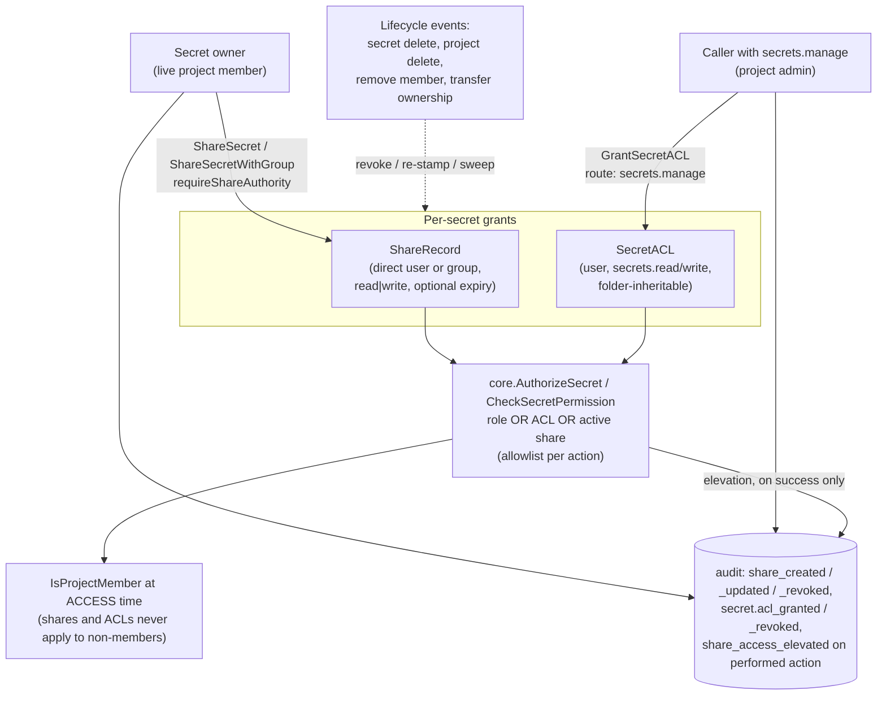

# Threat Model: Sharing and secret ACLs

> Part of [`docs/security/threat-models/`](README.md). Narrows
> [`../threat-model.md`](../threat-model.md) to the per-secret grants that
> sit *beside* project roles: `ShareRecord` (direct and group shares),
> `SecretACL` grants, share elevation (a project viewer holding a write
> share), revoke, ownership transfer, and the soft-delete / restore
> cascade. Role resolution itself is in
> [authorization-rbac.md](authorization-rbac.md); the transport chokepoint
> is in [server-api.md](server-api.md).
>
> Evidence cells name a function or file and the test that proves it. A
> mitigation with no proving test on `main` is written as a **GAP**, not a
> claim. `TestThreatModelEvidence_CitedFilesAndTestsExist`
> (`internal/threatmodelcheck`) checks that every cited path and `Test` function
> exists; it does not check that the test proves the mitigation.

## 1. System context

A member's effective permission on one secret is
`max(role permission, active share permission)` (decision #2941). A
`SecretACL` row is a second, independent additive grant. Both can only add
access; neither applies to a user who is no longer a project member.

## 2. Trust boundaries

| Boundary | What crosses it | Enforcement |
|---|---|---|
| Owner → recipient (share creation) | A grant to another project member, or to a group scoped to the project | Owner gate `requireShareAuthority` (owner **and** live project member); recipient / group project-scope check |
| Share holder → secret | A read or write on one secret outside the holder's role | `sharePermissionFor` with the per-action allowlist `secretActionShareElevates`; membership re-checked on every decision |
| Project admin → ACL | A per-secret grant, optionally on a folder | `secrets.manage` at the secret's project scope on the route (HTTP `RequireScopedSecretPermission`, gRPC `authorizeSecretScoped`) |
| Machine identity ↔ user grants | A machine principal ID can collide numerically with a user ID | Machine principals skip ACL and share terms (separate ID space) |
| Lifecycle (delete / restore / purge) ↔ grants | A grant that survives a delete returns on restore | Same-transaction revoke in the delete path; see SHARE-13 for what is still open |

## 3. Threat table

| ID | STRIDE | Description | Mitigation | Evidence link | Residual risk / GAP |
|---|---|---|---|---|---|
| SHARE-1 | Elevation of privilege | A user who is not the secret's owner (or whose owner authority lapsed because they left the project) shares the secret, handing a third party access. | `requireShareAuthority` is the single owner gate of every share mutation (`ShareSecret`, `ShareSecretWithGroup`, `UpdateSharePermission`, `RevokeShare`): the actor must own the secret **and** be a live project member (RBAC-001). An ownerless (machine-created) secret cannot be shared. | `internal/core/share_authz.go` `requireShareAuthority`; `TestKeyorixCore_ShareSecret_DepartedOwnerDenied`; `TestKeyorixCore_UpdateSharePermission_DepartedOwnerDenied`; `TestKeyorixCore_RevokeShare_DepartedOwnerDenied`; `TestShareSecretWithGroup_NonOwnerDenied`; `TestShareSecretWithGroup_DepartedOwnerDenied` | None identified. A project admin who is not the owner cannot share on the owner's behalf; they use `TransferSecretOwnership` or an ACL (SHARE-9, SHARE-12). |
| SHARE-2 | Elevation of privilege | A share to a user who is not (or is no longer) a member of the secret's project gives an outsider standing access. | Checked twice: at creation (`ShareSecret` calls `IsProjectMember`, refuses with `ErrShareRecipientNotMember`) and at **access time** (`activeShareGrant` checks `IsProjectMember` last, so a removed member's leftover `ShareRecord` grants nothing). | `internal/core/share_authz.go` `activeShareGrant`; `TestShare2976_RecipientWhoIsNotAProjectMember_IsToldWhy`; `TestShareElevation2941_ShareStopsApplyingWhenRecipientLeavesProject`; `TestShareTerm_CheckSecretPermission_NonMemberShareGrantsNothing`; `TestShareElevation2941_GRPC_ShareToNonMemberGrantsNothing` | None identified. `RemoveProjectMember` does not delete share rows (they stay inert while the user is a non-member and become live again if the user is re-added to the project; the owner can revoke them in the meantime). |
| SHARE-3 | Elevation of privilege | **Share elevation.** A project viewer holding a *write* share uses it for more than the owner meant: delete, manage, re-share, suspend, move, roll back, change classification or lifecycle. | The share term grants `secrets.read`, or `secrets.write` only for the allowlisted actions `secret.update`, `secret.update_metadata`, `secret.rotate` (`secretActionShareElevates`, enforced in `sharePermissionFor` only). Never `secrets.delete`, `secrets.manage`, owner, or the right to share. A level outside `read`/`write` (corrupt row) grants nothing (`shareLevel`). An unnamed action is not elevated. | `internal/core/share_authz.go` `secretActionShareElevates`; `TestSecretActionAllowlist_ElevatedSetIsExactlyTheDecision`; `TestSecretActionAllowlist_ShareTermDecidesPerAction`; `TestWriteShareMatrix_EverySecretsWriteRoute`; `TestShareElevation2941_WriteShareNeverGrantsDeleteManageOrShare`; `TestShareElevation2941_ReadShareDoesNotGrantWrite`; `TestShareTerm_AuthorizeSecret_MaxOfRoleAndShare` | **Accepted design (#2941).** A write-share holder can replace or rotate the secret's value, which can break its consumers. That is what a write share means; the owner chooses read when that is not wanted. Every elevated action is audited (SHARE-5). |
| SHARE-4 | Elevation of privilege | A new route, RPC or `SecretAction` is added without the share term, or a new write action is added without an allowlist decision, silently widening (or bypassing) share elevation. | Structural guards: every `SecretAction` must have an explicit allowlist entry; only the share term may reach the raw share lookup; both decision functions must call `sharePermissionFor`; every secret RPC must use the share-aware gate and every `secrets.write` RPC must name its action. | `TestSecretActionAllowlist_EveryActionHasAnExplicitDecision`; `TestSecretActionAllowlist_OnlyTheShareTermReachesTheRawShareLookup`; `TestShareTerm_DecisionFunctionsConsultIt`; `TestEverySecretRPC_UsesShareAwareGate`; `TestSecretsWriteRPCs_NameTheirAction`; `TestAuthzParity_HTTPvsGRPC_ShareCreate` | None identified for the share term. The HTTP per-route gate is covered by `TestWriteShareMatrix_EverySecretsWriteRoute`, which enumerates the routes. |
| SHARE-5 | Repudiation | A share-elevated write leaves no record that a share (not the role) authorized it, or a refused request leaves a false record. | The elevation is recorded on the request's `ShareElevationRecorder` when decided and written as `share_access_elevated` (with the share id, actor and level) only when the transport reports the action performed (HTTP 2xx, gRPC nil error). Share create / update / revoke each write their own event after the storage mutation succeeded. | `internal/core/share_authz.go` `CommitShareElevations`; `TestShareElevationAudit_RecordedThenCommitted`; `TestWriteShareAudit_OnPerformedActionOnly`; `TestShareElevation2941_AuditCarriesShareID`; `TestServerChain_HasShareElevationAuditInterceptor` | None identified. A role- or ACL-made decision deliberately writes no elevation event. |
| SHARE-6 | Elevation of privilege | An expired time-bound share keeps authorizing until a sweeper reclaims the row. | `activeShares` drops expired shares before every decision; a past expiry is refused at creation and at update; a sweeper (`RemoveExpiredShares`) reclaims expired rows and audits `share.expired`. | `internal/core/share_authz.go` `activeShareGrant`; `TestShareExpiry_Enforcement`; `TestShareElevation2941_ExpiredShareGrantsNothing`; `TestUpdateShareExpiry`; `TestRemoveExpiredShares` | None identified. Expiry uses the server clock; a skewed replica clock shifts the cut-off by the skew (see [ha-consistency.md](ha-consistency.md)). |
| SHARE-7 | Tampering / repudiation | Revoking a share leaves a half state: row deleted but no audit trail, or an audit record for a revoke that did not happen. | `RevokeShare` deletes inside `WithTransaction`, and writes the audit event and notification only after the delete succeeded. A revoked share is a deleted row, so it grants nothing by construction. | `internal/core/sharing.go` `RevokeShare`; `TestKeyorixCore_RevokeShare_NoPhantomAuditOnDeleteFailure`; `TestShareElevation2941_WriteShareLetsViewerUpdate_RevokeRemovesExactlyThat`; `TestRemoveSelfFromShare_NoPhantomAuditOnDeleteFailure` | The revoked-user notification is best-effort and may be lost; the revoke itself is not. `RemoveSelfFromShare` deletes without a wrapping transaction (it relies on the audit-after-success ordering only). |
| SHARE-8 | Elevation of privilege | A group share pulls in members who have no tie to the secret's project. | `ShareSecretWithGroup` requires the group to hold a live role in the secret's project (`IsGroupProjectScoped`); at access time each member must still be a live project member (SHARE-2). Both HTTP and gRPC route group shares to `ShareSecretWithGroup`; core `ShareSecret` is only called with `IsGroup: false`. | `internal/core/group_sharing.go` `ShareSecretWithGroup`; `TestShareSecretWithGroup_CrossProjectRefused`; `TestCheckSharePermission_ProjectScopedMembershipDoesNotCrossProjects` | Defence in depth: core `ShareSecret` still accepts `IsGroup: true` without the group-scope check. No current caller reaches it (both transports hard-code `IsGroup: false`); no test asserts that. **GAP #3422** (design decision, low): add the same check to core `ShareSecret`, or make `IsGroup: true` an error there, with a test. |
| SHARE-9 | Elevation of privilege | A user without authority grants a per-secret ACL, or grants one to someone outside the project. | `GrantSecretACL` / `RevokeSecretACL` / `ListSecretACLs` are routed behind `secrets.manage` at the secret's project scope; `GrantSecretACL` requires a valid permission subset and a grantee who is a live project member; `RevokeSecretACL` checks the ACL id belongs to the named secret. | `internal/core/secret_acl.go` `GrantSecretACL`; `TestSecretACL_EndToEnd_PerSecretRoutes`; `TestGrantSecretACL_NonMemberUser`; `TestGrantSecretACL_PermissionDenied`; `TestRevokeSecretACL_WrongSecret` | The `secrets.manage` check lives in the transports, not in the core functions (`GrantSecretACL`'s own doc comment says so). Today the only callers are the HTTP handler and the gRPC service; no guard test fails if a third caller skips the gate. **GAP #3423** (design decision, low): a registry test over the callers of `GrantSecretACL` / `RevokeSecretACL`, or move the check into core. |
| SHARE-10 | Elevation of privilege | An offboarded user keeps per-secret access through a leftover `SecretACL` row. | `RemoveProjectMember` deletes the member's ACLs for the project, and `aclGrantsPermission` re-checks live project membership at authorization time (fail closed on a lookup error), so a gap in the cleanup cannot leave a usable grant. | `internal/core/secret_acl.go` `aclGrantsPermission`; `TestHasSecretACL_DeniesStaleGrantAfterMembershipRemoved`; `TestAuthorizeSecret_DeniesStaleGrantAfterMembershipRemoved`; `TestRemoveProjectMember_RevokesSecretACLGrants` | None identified. |
| SHARE-11 | Spoofing / elevation of privilege | A machine identity whose numeric ID equals a user ID inherits that user's ACL or share. | Machine principals never take the ACL or share path (`AuthorizeSecretPrincipal`); share recipients and ACL grantees are user IDs only. | `internal/core/share_authz.go` header limit 4; `TestAuthorizeSecretPrincipal_MachineSkipsACL`; `TestAuthorizeSecretPrincipal_UserACLGrant` | None identified. |
| SHARE-12 | Elevation of privilege | A grant on a folder reaches secrets it should not (a sibling folder), or a folder cycle loops the check. | `HasSecretACL` walks only the target's own ancestor chain via `GetSecretAncestors`; a direct ACL is checked first; the walk is cycle-protected. | `internal/core/secret_acl.go` `HasSecretACL`; `TestHasSecretACL_UnrelatedFolderNotGranted`; `TestHasSecretACL_CycleProtection`; `TestHasSecretACL_DirectOverridesFolder` | **By design:** a folder grant covers every descendant secret, including secrets created in the folder later. The grant is visible in the folder's ACL list. |
| SHARE-13 | Elevation of privilege / repudiation | **Soft-delete and restore cascade.** Access granted before a delete returns on restore with no re-authorization. | `DeleteSecret` revokes the secret's `ShareRecord` rows **and** `SecretACL` rows in the same transaction (#370 / CWE-284). The project cascade (`deleteProjectCascade`) revokes the project's `ShareRecord` rows in its transaction. `RestoreSecret` / `RestoreProject` do not bring grants back. `DeleteProjectIfEmpty` takes the project row lock before counting (#2796/#2887). The project cascade also revokes the project's `SecretACL` rows (#2798), and both `DeleteSecret` and the cascade close approved secret-scoped `AccessRequest` rows (`closeApprovedSecretAccessRequests`, #2797), so neither revives on restore. `ResumeSecret` takes the environment guard and `LockLiveProject` and refuses inside a deleted environment or project (#2794). `PurgeDeletedProjectsBefore` deletes the project's `machine_identity_roles` with the project (#2795). A re-share (`CreateShareRecord`, #2801 / #2802, fixed in b8ce46cfc) goes through one helper, `reshareOntoLiveRow`, on both its update path and its unique-violation fallback; its only write is `applyShareRequest` (permission, `expires_at`, `updated_at`) conditioned on `id` and `deleted_at IS NULL`, and a miss fails closed with `ErrShareNotFound`, so a share revoked between the read and the write is not resurrected and a time-bound re-share that loses the create race keeps the caller's expiry. | `internal/storage/store/local_secrets.go` `DeleteSecret`, `DeleteProjectIfEmpty`; `internal/storage/store/local_sharing.go` `reshareOntoLiveRow`; `internal/storage/store/local_purge.go` `PurgeDeletedProjectsBefore`; `internal/core/secret_suspend.go` `ResumeSecret`; `TestDeleteSecret_RevokesActiveShares`; `TestDeleteSecret_RevokesSecretACLs`; `TestDeleteProject_RevokesActiveSharesForProjectSecrets`; `TestDeleteProjectCascade_RevokesSecretACLs_NotRevivedByRestoreProject`; `TestDeleteSecret_ClosesApprovedSecretAccessRequests_NotRevivedByRestoreSecret`; `TestDeleteProjectCascade_ClosesApprovedSecretAccessRequests_NotRevivedByRestoreProject`; `TestPurgeDeletedProjectsBefore_RemovesMachineIdentityRoles`; `TestResumeSecret_RefusedInDeletedEnvironment`; `TestResumeSecret_RefusedInDeletedProject`; `TestCTAReview_ResumeSecret_vs_DeleteProject_CrossReplicaPostgres` (Postgres-gated); `TestConcurrency_DeleteProjectIfEmpty_LockFirstPreventsOrphanedDelete` (Postgres-gated, two connections); `TestCreateShareRecord_RevokeBetweenReadAndWrite_StaysRevoked`; `TestCreateShareRecord_LostCreateRace_KeepsCallerExpiry`; `TestCreateShareRecord_LostCreateRace_WinnerRevoked_StaysRevoked`; `TestCreateShareRecord_IsColumnScoped` | **GAP #2795 (defence in depth, read side):** `GetUserRoleIDsAt`, `GetUserGroupRoleIDsAt` and `GetMachineRoleIDsAt` test `projects.deleted_at IS NULL` behind a `LEFT JOIN`, which reads a *missing* project row as live; the purge now removes the grant rows so the case cannot arise from it, but the readers still fail open if a grant ever outlives its project row. They are read-path permission lookups owned by OPT-READPATH-2. |
| SHARE-14 | Elevation of privilege | **Transfer.** Ownership (which includes the right to share and revoke) is handed to someone who should not hold it, or taken from a live owner; or the previous owner keeps shares they can no longer revoke. | `TransferSecretOwnership` / `transferOwnership`: the actor must be the live owner, or (owner gone) hold `roles.assign`; the new owner must already hold `secrets.write` or `secrets.manage` at the scope; a transient owner-lookup error fails closed; the secret's owner and all its share rows are re-stamped in one transaction, with no recipient, permission or expiry changed. | `internal/core/secret_ownership.go` `transferOwnership`; `TestTransferSecretOwnership`; `TestTransferSecretOwnership_ReownsShares`; `TestTransferOwnership_ReownsSharesOverREST`; `TestCTAReview_TransferOwnership_vs_RevokeShare_CrossReplicaPostgres` (Postgres-gated) | None identified. |

## 4. Residual risks specific to this component

- Share elevation is a deliberate widening (SHARE-3): the owner's choice of
  `write` lets a viewer replace or rotate the value. The allowlist is the
  control; widening it is a decision, and the guards in SHARE-4 make a
  silent widening fail the build.
- Notifications about shares and revokes are best-effort. The grant state,
  not the notification, is authoritative.
- The soft-delete cascade revokes shares and ACLs and closes approved access
  requests in the delete transaction (SHARE-13); the one open piece is the
  read-side hardening of #2795.
- System-wide residuals (the authentication cache window, in-process
  secret exposure) apply via the shared read path and are not re-derived;
  see [authentication.md](authentication.md) and [server-api.md](server-api.md).
